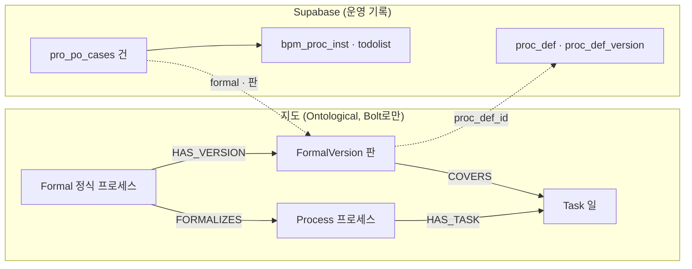
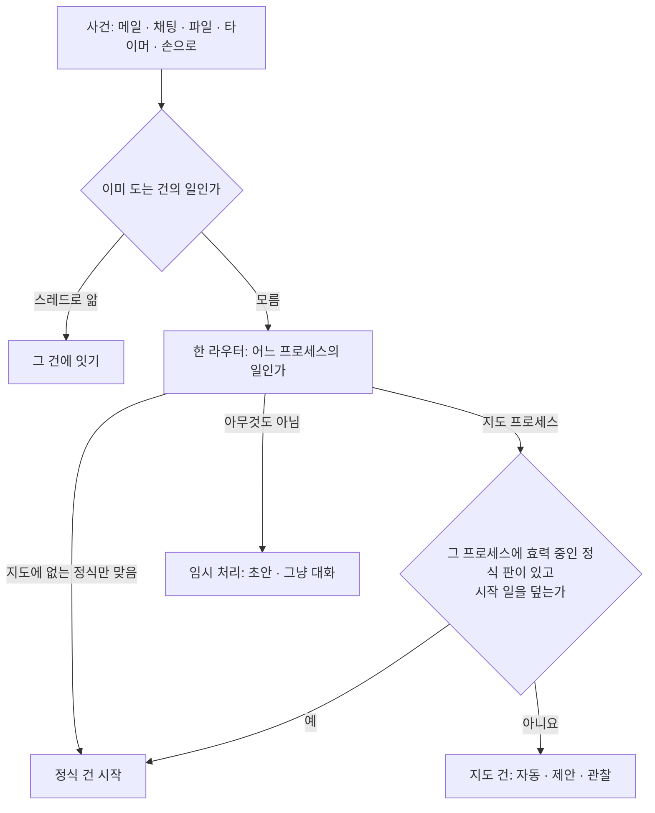

# 정식 프로세스와 프로세스 지도를 함께 쓰기 — 설계안 v0.1

- 날짜: 2026-11-28
- 상태: 설계안(구현 전). 6절의 「정할 것」에 답을 받은 뒤 구현 계획으로 넘어갑니다.
- 기준 코드: `origin/main` 2da565d
- 범위: Process GPT Lite(프런트 `src/`, 서버 `server/`). Process GPT 본판의 엔진(completion)은 고치지 않는 것을 전제로 합니다.

요청(2026-11-28):

> 「지금 현재 프로세스 실행 기능은 두가지 패턴이 있다. 하나는 기존 클래식 방식으로 정해진 프로세스 대로 흐름을 가져가는 방식과 프로세스 지도를 통해 자유롭게 실행되는 일종의 case management 방식. 그런데 기업에는 두가지 방식이 다 유용할 수 있다. 이에, 두가지 방식을 혼합하면서 기존 클래식 방식에서의 프로세스 마이닝 방식은 (https://www.uengine.org/docs/process-gpt-lite/mining.html ) 이번에 새롭게 고안된 프로세스 지도 방식을 그대로 이용하면서 상황에서 프로세스를 동적으로 선택해가는 프로세스 지도 방식(case mangement 방식)과 정해진 프로세스대로 흐르는 클래식 방식을 상존 시키면서 프로세스 지도에서 정형화 하고 싶을때 이를 정식 프로세스로 등록하는 것도 가능하도록... 설계안을 먼저 만들어보자. 상충하는 상황들도 예측해보자.」

이 문서에서 쓰는 말:

| 말 | 뜻 |
|---|---|
| 정식 프로세스 | 등록한 프로세스 정의대로 흐르는 방식(요청의 「클래식 방식」) |
| 지도 흐름 | 회사 프로세스 지도에서 다음 일을 그때그때 고르는 방식(요청의 「case management 방식」) |
| 건 | 일 한 건. 정식이든 지도든 건 하나에 화면 하나 |
| 지도 찾기 | 메일 · 대화 · 인계 기록에서 지도를 산출하는 일(지도 쪽의 마이닝) |
| 클래식 마이닝 | 인계 기록 → 패턴 추천 → 정식 등록으로 이어지는 현재의 `lib/mining` |

---

## 1. 요약

### 1.1 한 줄 요약

회사가 일하는 방식의 원본은 프로세스 지도 하나로 두고, 정식 프로세스는 그 지도의 한 구간을 「이대로 하기로 정해 얼려 둔 판」으로 만든다. 새 일은 한 곳에서 한 번만 읽어 정식이면 정의대로, 아니면 지도대로 실행한다. 정식 건의 기록은 지도로 돌아가되, 그 기록이 지도를 스스로 굳히지 않도록 따로 센다.

### 1.2 한 쪽 요약 — 쓰는 사람에게 달라지는 것

**일하는 사람**

- 메일이나 요청이 들어오면 지금처럼 건이 열립니다. 그 일이 정식 프로세스에 해당하면 정해진 순서대로, 아니면 지도가 권하는 다음 일로 갑니다. 화면은 같습니다. 건 머리글에 「정식」 또는 「지도」 표시만 다릅니다.
- 같은 메일로 건이 두 개 열리거나 같은 할 일이 두 번 오지 않습니다. 시작을 정하는 곳이 하나가 되기 때문입니다.
- 정식 건에서 정해진 길을 벗어나야 하면, 까닭을 적고 벗어날 수 있습니다(「안내」 정식). 감사가 필요한 프로세스(「엄격」 정식)는 승인을 받아야 벗어날 수 있습니다. 벗어난 내용은 모두 기록됩니다.

**관리자**

- 「추천」이 한 곳에서 옵니다. 클래식 마이닝의 추천 화면 대신, 지도에서 충분히 굳어진 흐름에 「정식 등록 후보」가 뜹니다.
- 지도에서 프로세스(또는 그 일부)를 골라 「정식으로 등록」을 누르면 BPMN 미리보기 → 미정인 갈림길 결정 → 등록 순으로 진행합니다. 등록한 프로세스는 판(버전)이 있는 프로세스 정의가 됩니다.
- 정식 프로세스가 실제와 어긋나기 시작하면(같은 곳에서 자꾸 벗어남, 아무도 가지 않는 단계) 지도가 「개정 제안」을 올립니다. 개정하면 새 판이 생기고, 실행 중인 건은 시작한 판으로 끝까지 갑니다.
- 이미 클래식 마이닝으로 정식 등록한 프로세스는 그대로 실행됩니다. 원할 때 지도에 연결합니다(자동 초안 + 확인).

**지도 저장소가 없는 회사**

- 지금과 같습니다. 정식 프로세스와 클래식 마이닝만 씁니다. 이 설계의 새 기능은 지도 저장소가 있을 때만 켜집니다.

### 1.3 핵심 선택 다섯 가지

| # | 선택 | 까닭 |
|---|---|---|
| 1 | 정식 프로세스는 지도와 다른 세계가 아니라 지도 위의 「얼린 구간」 | 원본이 둘이면 반드시 어긋난다 |
| 2 | 새 일은 한 라우터가 한 번만 읽는다. 같은 일에 둘 다 맞으면 정식이 먼저 | 중복 건 · 중복 할 일을 시작 단계에서 막는다 |
| 3 | 정식 건의 기록은 지도로 돌아가되 「정해져서 간 길」로 따로 센다 | 정식이 지도를 스스로 굳히는 것을 막는다 |
| 4 | 정식에는 엄격도가 있다: 「안내」(기본) · 「엄격」 | 자유와 감사 중 무엇을 중시할지 프로세스마다 고르게 한다 |
| 5 | 클래식 마이닝은 지우지 않고, 지도가 있는 회사에서만 지도 찾기로 대체한다 | 지도 없는 설치판의 기존 동작을 유지한다 |

---

## 2. 지금 — 코드로 확인한 사실

### 2.1 실행 방식은 사실 셋이다

요청은 두 가지를 말하지만, 코드에서는 지도 쪽이 두 갈래로 나뉘어 모두 셋입니다. 가운데 방식(스냅샷)이 이미 두 세계를 잇는 다리입니다. 이 설계는 그 다리를 넓힙니다.

| | 가. 정식(클래식) | 나. 지도 스냅샷 | 다. 지도에서 바로 |
|---|---|---|---|
| 흐름의 원본 | `proc_def`(등록한 정의) | 지도 → 건마다 펼친 `proc_def`(`onto_…`) | 지도(정의 없음) |
| 누가 다음을 정하나 | completion 엔진 | completion 엔진(스냅샷 안에서) | Lite가 단계마다 지도를 읽음 |
| 건의 행 | 없음(`bpm_proc_inst`만) | `pro_po_cases`(engine `bpm`) | `pro_po_cases`(engine `map`) |
| 벗어남 | 방법 없음 | 인스턴스를 닫고 새 스냅샷으로 | 같은 인스턴스 안에서 옮김 |
| 코드 | `server/lib/engine.js` `startProcess` · `submitTodo` | `server/lib/ontology/run.js` `snapshot` · `startCase` · `moveCase` | `server/lib/ontology/mapengine.js` `startMapCase` · `nextOf` · `advance` |

- 나 · 다 가운데 무엇을 쓸지는 회사 단위로 설정합니다(`mapengine.js` `engineOf`: 환경 변수 → 회사 설정 → 제품 기본값). 제품 기본값은 `bpm`, 즉 스냅샷입니다(`skills/process-discovery/rules.json`의 `mapEngine.default`).
- 스냅샷의 키는 「프로세스 · 시작 일 · θ · 구조 해시 · 통계 주차 · 시작한 사람의 역할」입니다(`run.js` `snapshot`). 지도나 주차가 바뀌면 다음 건부터 새 정의가 만들어집니다. 실행 중인 건은 시작한 정의로 끝까지 갑니다.
- 스냅샷 정의의 액티비티 id는 일 이름의 해시입니다(`run.js` `actId`: `t_` + sha1 앞 10자).

### 2.2 건이 시작되는 길

**메일** — 처리 순서가 코드에 정해져 있습니다(`server/lib/mail.js` `pollUser`).

1. 이미 실행 중인 인스턴스에 묶인 스레드의 메일이면 그 인스턴스로 들어갑니다(`server/lib/mailFlow.js` `linkByThread`, 모델 없음).
2. Home 카드를 만든 메일은 지도 라우터가 읽습니다(`mailFlow.js` `routeMailCards` → `server/lib/ontology/events.js` `routeEvent`). 「자동」 프로세스는 자동으로 시작하고, 「제안」은 카드에서 묻고, 「관찰」은 읽지 않습니다. 시작 직전에 「이미 도는 같은 일인가」를 판정 모델로 한 번 더 확인합니다(`mailFlow.js`의 `judge`, 문턱 `joinMin` 0.7).
3. 지도가 받지 않았으면 클래식 마이닝으로 정식 등록한 프로세스가 받습니다(`server/lib/mining/service.js` `routeMail`). 메일의 업무 범주를 모델로 정하고(`mailCategory`), 같은 범주로 등록한 정의를 `startProcess`로 시작합니다. 같은 범주가 둘이면 나중에 등록한 정의를 씁니다.
4. 그것도 아니면 임시 초안을 만듭니다(`mail.js` `draftFromMail`).

**채팅** — 경로가 둘이고 서로의 결과를 알지 못합니다.

- 정의를 이름으로 시작: 대화 에이전트의 도구가 정의 목록에서 고릅니다(`server/lib/agent.js` `processTurn` → `pickDefinition`, 모델이 목록에서 하나 고름).
- 지도: 턴이 끝난 뒤 그 말이 지도 프로세스의 시작을 뜻하는지 읽고 카드로 묻습니다(`run.js` `chatSuggest`, `events.js` `onChat`). 자동으로 시작하지는 않습니다.

**정해 둔 시각** — 이것도 둘입니다.

- 개인 예약이 정의를 시작(`server/lib/missions.js`에서 `startProcess({ defId: s.process_id })`).
- 회사 타이머가 지도 건을 시작(`server/lib/ontology/timers.js`에서 `startCase`). 타이머는 그래프의 사건(Event, kind timer)을 기준으로 합니다.

**손으로** — `POST /processes/:id/start`(`server/routes/process.js`)와 지도의 건 시작(`server/routes/ontology.js`에서 `R.startCase`).

### 2.3 다음 단계를 누가 고르나

| | 정식 | 지도 |
|---|---|---|
| 갈림 | 정의의 게이트웨이 조건을 엔진이 읽음 | 스냅샷: 같음. 지도에서 바로: `mapengine.js` `nextOf` — 학습한 금액 조건 → 글로 쓴 갈림길 조건(`steprule.js` `readYes`) → 가장 흔한 길 |
| 꼭 · 선택 | 정의에 반영(`server/lib/mining/shape.js`: 필수 = 돌아갈 길 없음, 옵션 = 조건 달린 배타 게이트웨이) | 간선 설정(`server/lib/ontology/edgecond.js`) · 고정. 단계가 열릴 때 읽음(`steprule.js`) |
| 사람이 끼는 곳 | 없음. 정의대로 진행 | 관문(`server/lib/ontology/runmode.js` `gateStep`): 프로세스의 단계가 방식을 정함(`modeOfStage`: 자동 → 사람이 지켜봄, 제안 → 단계마다 사람이 정함) |

`gateStep`은 건의 행이 없으면 바로 「진행」을 반환합니다(`runmode.js`: `caseOfInstance`가 null이면 `{ act: 'run' }`). 즉 정식 인스턴스에는 관문이 없습니다.

### 2.4 기록과 마이닝

**클래식 마이닝**(`server/lib/mining/*`, 튜토리얼 20장)

- 메일 한 통이 사례 하나입니다(`recorder.js` `openCase`, `pro_mining_cases` 테이블). 초안 · 팀 공유 · 고객 회신이 `handover_events`에 한 행씩 남습니다(`recordStep`). 단계 이름은 코드의 목록(`catalog.js` `STEPS`)에 있는 것만 남습니다.
- 서버가 1분마다 process-miner 서비스에 묻습니다(`server/routes/mining.js` `startMiningScan`, `service.js` `scan`). 추천은 `pro_mining_suggestions` 테이블의 행입니다.
- 관리자가 대화로 필수 · 옵션 · 택일 · 조건을 정합니다(`talk.js`, `boundary.js`, `shape.js`, `branch.js`). 정하지 않은 갈림길이 있으면 등록을 막습니다(`service.js` `registerIn`의 `openBranches`).
- 「정식 등록」은 본판의 저장 경로로 정의를 저장합니다(`server/lib/generated.js` `saveGenerated`). 미리 본 정의와 같은지 토큰으로 확인합니다(`contractToken`). 사람이 맡을 역할은 그 일을 해 온 팀원에게 배정합니다(`pro_role_assignments`, 정의 id 단위).
- 등록 프로세스가 처리한 메일은 인계 기록을 남기지 않습니다(스펙 `openspec/specs/mining-suggestion/spec.md` 「정식 등록된 프로세스가 맡은 메일」). 즉 사례로 다시 쌓이지 않습니다.

**지도 찾기**(`server/lib/ontology/*`)

- 입력은 두 테이블뿐입니다: `handover_events`와 `pro_mail_history`(`build.js` `loadEvents`). `handover_events`는 출처로 거르지 않으므로, 클래식 recorder가 남긴 행도 이미 지도의 입력입니다.
- 지난 메일은 깔때기 방식으로 읽습니다(`history.js`). 받기만 한 메일은 뺍니다(`engagement.js`). 끊긴 건은 판정 모델로 잇습니다(`streams.js`).
- 계산은 순수 함수로 처리합니다(`stats.js`): 일 · 넘어감 · 확률 · θ · 반감기 · 은퇴(포아송 검정).
- 사람이 고친 내용은 원본을 지우지 않고 위에 얹습니다(`refine.js`의 `pro_corrections`, `editmap.js`).
- 문서에서 읽은 절차는 찾은 프로세스와 섞지 않고 따로 둡니다(`documents.js`: `Document → Procedure → Step`, `Step -[SAME_AS]-> Task`). 화면에는 「문서대로 · 실제로」를 나란히 보여 줍니다.

**실행 건의 기록은 지도 계산에 들어가지 않습니다.** `loadEvents`는 `todolist`를 읽지 않습니다. 실행 건이 지도에 남기는 것은 옮기기 기록뿐입니다(`run.js` `moveCase` · `mapengine.js` `moveMap`이 `handover_events`에 한 행, `learn`일 때만). 흐름 분석(`flowload.js`)은 `todolist`를 읽지만 시간과 쌓인 양을 재는 데만 씁니다.

### 2.5 화면

- 위쪽 탭 「프로세스」는 지도를 엽니다. 지도 저장소가 없는 회사는 루틴 목록을 엽니다(`src/components/TopBar.vue` `go`: `app.me?.ontology === false ? '/routines' : '/process-map'`).
- 루틴 목록은 두 종류를 함께 보여 줍니다(`src/components/RoutineList.vue`: `isLite = !!i.case_id`). 서버가 인스턴스마다 건의 행을 붙여 줍니다(`server/lib/processes.js` `listInstances`의 `pro_po_cases` 조인).
- 열리는 화면은 종류마다 다릅니다(`src/components/ontology/caseView.js` `routineTarget`): 지도에서 바로 실행되는 건과 정식 인스턴스는 인스턴스 화면, 스냅샷 건은 지도의 건 패널.
- 지도에서 바로 실행되는 건은 볼 때마다 그 건의 BPMN을 그립니다(`server/lib/ontology/casebpmn.js`). 아무것도 저장하지 않습니다.
- 클래식 마이닝 화면은 `/mining/:id?`(`src/views/MiningView.vue`), 클래식 개선 분석은 `/improve/:defId?`(`src/views/ImproveView.vue`)입니다.

### 2.6 이미 같이 쓰는 것, 겹치는 것

**같이 쓰는 것**

| 무엇 | 어디 |
|---|---|
| 할 일 테이블 `todolist` | 셋 다 여기에 단계를 넣음. 내 할 일은 한 질의로 조회(`processes.js` `myTodos`) |
| 인스턴스 테이블 `bpm_proc_inst` | 지도에서 바로 실행되는 건도 한 행을 둠(`mapengine.js` `syncInst`) |
| 정의 저장 | 스냅샷과 클래식 등록이 같은 `saveGenerated`를 사용 |
| 인계 기록 `handover_events` | 클래식 recorder · 폴더 인계 · 회의 · 옮기기가 쓰고, 지도 찾기와 process-miner가 읽음 |
| 단계 스킬 일꾼 | 지도 단계가 클래식 일꾼의 함수를 씀(`run.js` `prevOf` → `mining/worker.js` `earlier`) |
| 인스턴스 대화 · 알림 | `engine.js` `instanceThread` · `notifyInstance` |
| 역할 → 사람 | `pro_role_assignments`(회사 전체는 `'*'`) |

**겹치는 것(두 벌)**

| 무엇 | 정식 쪽 | 지도 쪽 |
|---|---|---|
| 메일 → 프로세스 판정 | 업무 범주(`mining/service.js` `mailCategory`) | 프로세스마다 예/아니요(`events.js` `identify`) |
| 반복 흐름 찾기 | process-miner(`PRO_MINER_URL`) | `build.js` + `stats.js` |
| 필수 · 옵션 · 조건 | `shape.js` · `branch.js` | `edgecond.js` · `conditions.js` · `steprule.js` |
| 단계의 양식 · 스킬 | 코드 목록 `catalog.js` `STEPS` | 일 정의 `taskdef.js`(일 노드에 둠) |
| 단계 일꾼 | `pgpt-pro-skill`(`mining/worker.js`) | `pgpt-pro-onto`(`run.js` `runStep`) |
| 개선 분석 | 정의 단위(`server/lib/improve/*`) | 지도 단위(`flowload.js` · `flowtime.js` · `flowplan.js`) |
| 추천을 다루는 대화 | `mining/talk.js` | `editmap.js` · `opinions.js` |
| 정해 둔 시각 | `missions.js`(정의 시작) | `timers.js`(지도 건 시작) |

---

## 3. 목표와 원칙

### 3.1 목표

1. 두 방식이 한 회사 안에서 함께 실행된다. 일하는 사람은 방식을 고르지 않아도 된다.
2. 정식 프로세스를 찾는 길(마이닝)은 지도 찾기 하나다.
3. 지도에서 굳어진 흐름을 정식 프로세스로 등록할 수 있다. 전체도, 일부도 가능하다.
4. 정식 건의 실제 기록이 지도로 돌아가고, 어긋나면 개정으로 이어진다.
5. 지도 저장소가 없는 회사는 지금 그대로 동작한다.

### 3.2 원칙

**원칙 1. 원본은 지도 하나.** 이전 결정(design-v0.3 §11: 프로세스에 관한 지식은 Ontological 그래프에, Supabase에는 운영 기록만)을 그대로 따릅니다. 정식 프로세스가 「무엇을 덮는지」는 그래프에, 엔진이 실행할 정의는 지금처럼 `proc_def`에 둡니다.

**원칙 2. 정식 프로세스는 지도의 얼린 구간이다.** 따로 그린 그림이 아니라, 어느 날의 지도에서 한 구간을 펼쳐 이름과 판을 붙인 것입니다. 지금의 스냅샷과 만드는 법이 같고, 「주마다 다시 만들지 않는다」는 점만 다릅니다.

세 가지 안을 비교했습니다.

| 안 | 내용 | 판단 |
|---|---|---|
| A. 두 세계 유지 | 지금처럼 정의와 지도를 따로 둠 | 제외. 5절의 상충 대부분이 여기서 나옴 |
| B. 프로세스 노드의 속성 | 지도의 프로세스에 「정식」 표시만 붙임 | 제외. 일부만 정식화 · 여러 판 · 지도에 뿌리 없는 정의를 담지 못함 |
| C. 지도 위의 별도 노드 | 문서 절차(`Procedure`)처럼 따로 두고 일(Task)에 묶음 | **권고.** 이미 같은 구조가 있고(`documents.js`), 「정한 대로 · 실제로」를 나란히 볼 수 있음 |

**원칙 3. 한 번만 읽는다.** 들어온 일이 어느 프로세스에 해당하는지는 한 곳에서 한 번 판정합니다. 정식이냐 지도냐는 판정하는 것이 아니라 그 프로세스의 상태를 읽는 것(구조 규칙)입니다.

**원칙 4. 정해져서 간 길과 골라서 간 길을 구분한다.** 정의에 따라 간 길은 사람이 고른 길과 증거의 무게가 다릅니다. 따로 셉니다.

**원칙 5. 지우지 않고 얹는다.** 다듬기의 원칙(plan-process-refinement §2-1)을 따릅니다. 정식 등록도 개정도 벗어남도 지도의 원본을 고치지 않고 기록을 얹습니다.

**원칙 6. 뜻은 모델이, 구조는 규칙이.** 「이 메일이 이 일인가」 「이 단계와 저 일이 같은 일인가」는 판정 모델(첫 토큰 확률, `server/lib/decide.js` `oddsOf`)과 스킬 프롬프트로 읽습니다. 낱말 · 정규식으로 뜻을 읽지 않습니다. 우선순위 · 판 · 효력일 · 집계는 규칙으로 처리합니다.

**원칙 7. 지도가 없으면 조용히 물러난다.** 새 기능은 모두 `ontologyEnabled()`(`server/lib/ontology/store.js`) 뒤에 둡니다.

---

## 4. 설계

### 4.1 하나의 모델

**그래프에 더하는 것**(타입과 속성은 설치 때 미리 선언합니다 — `store.js` 머리말의 규칙)

| 노드 · 관계 | 속성 | 뜻 |
|---|---|---|
| `Formal` | `key` · `name` · `strictness`(guided · strict) · `start`(auto · ask) · `owner_role` · `status`(active · retired) · `origin`(map · mined · drawn) | 정식 프로세스 하나 |
| `FormalVersion` | `key` · `version` · `proc_def_id` · `map_at`(펼친 지도의 시각) · `theta` · `entries` · `ways`(덮는 길 목록) · `exits`(구간 밖으로 나가는 길) · `made_by` | 판 하나. 효력 기간은 Ontological의 유효 시간 |
| `(Formal)-[:FORMALIZES]->(Process)` | | 어느 지도 프로세스를 정식화했나(없을 수 있음: 지도에 뿌리 없는 정의) |
| `(Formal)-[:HAS_VERSION]->(FormalVersion)` | | |
| `(FormalVersion)-[:COVERS]->(Task)` | `activity_id` · `order` · `by`(map · judge · admin) | 이 판의 액티비티가 지도의 어느 일에 해당하나 |

**Supabase에 더하는 것**

- `pro_po_cases.engine`에 값 `formal`을 더합니다(지금은 `bpm` · `map`, `server/sql/044_map_engine.sql`의 check 제약). 정식 건에도 건의 행을 둡니다. 열 `formal_key` · `formal_version`을 더합니다.
- `pro_formal_deviations` 테이블: 정식 건이 벗어난 곳마다 한 행(건 · 판 · 어디서 · 어디로 · 종류 · 까닭 · 승인한 사람 · 시각).
- 정의 자체는 지금처럼 `proc_def` · `proc_def_version`에 둡니다.

**왜 정식에도 건의 행을 두나.** 지금 정식 인스턴스는 건의 행이 없어서 관문 · 옮기기 · 되감기 · 건 묶기 · 지도 집계 어디에도 들어가지 않습니다(2.3). 건의 행 하나를 두면 이 기능들이 그대로 붙습니다.

### 4.2 일의 동일성

기준은 지도의 일 키(`Task.key`)입니다.

| 정식의 출처 | 액티비티 id | 일과 잇는 법 |
|---|---|---|
| 지도에서 등록 | 지금 스냅샷과 같은 `actId(일 이름)` | 만들 때 `COVERS`에 기록(`by: map`). 확실함 |
| 클래식 마이닝으로 등록한 기존 정의 | process-miner가 준 id(형식은 추정: 정의마다 다름) | 일 이름 맞추기(`server/lib/ontology/names.js` `resolveLabels`, 모델)로 초안 → 관리자 확인(`by: judge → admin`) |
| 본판에서 손으로 그린 정의 · 채팅으로 생성한 정의 | 정의의 id | 같음. 맞는 일이 없으면 「지도에 없는 단계」로 남김 |

- 집계는 해시가 아니라 `COVERS`를 따라 합니다. 지금 흐름 분석은 `activity_id = actId(일 이름)`으로 일과 행을 잇는데(`flowload.js`), 일 이름을 바꾸면 연결이 끊깁니다(design-improve-on-map §12가 남긴 물음). `COVERS.activity_id`를 두면 이름이 바뀌어도 연결이 유지됩니다.
- 지도 계산에서 같은 일의 다른 이름을 합칠 때(`build.js`가 부르는 `names.js` `consolidate`), 간선 설정의 키를 옮기는 곳(`edgecond.js` `renameTaskKeys`)에서 `COVERS`도 함께 옮깁니다.

### 4.3 판(버전)

| | 지도 스냅샷(지금) | 정식 판(새로) |
|---|---|---|
| 언제 새로 생기나 | 지도 구조 · 통계 주차 · θ가 바뀌면 자동으로 | 사람이 「개정」을 정할 때만 |
| 키 | 프로세스 · 시작 일 · θ · 구조 · 주차 · 역할 | `Formal.key` + 판 번호 |
| 이름 | `onto_…` (사람이 부르지 않음) | 회사가 붙인 이름 |
| 지도의 시각 | 만든 때 | `map_at`에 고정 |
| 실행 중인 건 | 시작한 스냅샷으로 끝까지 | 시작한 판으로 끝까지 |
| 효력일 | 없음 | 있음(미래 날짜 가능) |

- 판 번호는 본판의 `proc_def_version`을 그대로 씁니다. 인스턴스를 시작한 판에 묶는 것은 엔진이 이미 처리하고 있습니다(`server/lib/improve/service.js` `instancesWithVersion`의 주석: 시작할 때 판을 기록하고 유지).
- 한 `Formal`에 효력 중인 판은 하나입니다. 새 판의 효력일이 오면 앞 판은 새 건을 받지 않습니다.

### 4.4 새 건: 정식이냐 지도냐

**판정은 한 번.** `events.js` `routeEvent`가 읽는 후보에 정식 프로세스를 더합니다.

- 지도 프로세스에 묶인 정식(`FORMALIZES`)은 후보를 늘리지 않습니다. 그 프로세스가 맞으면 정식 여부는 그래프에서 읽습니다.
- 지도에 뿌리 없는 정식(옮기지 않은 기존 등록 정의)은 이름과 단계를 후보로 넣습니다. 지금의 업무 범주 판정(`mailCategory`)은 이 후보를 읽는 물음 하나로 합칩니다.

**우선순위(규칙)**

1. 이미 실행 중인 건에 잇기가 먼저입니다(지금과 같음).
2. 같은 프로세스 · 같은 시작 일에 정식과 지도가 모두 맞으면 **정식이 먼저**입니다. 회사가 정한 것이 찾은 것보다 앞섭니다.
3. 시작 일이 정식 구간 밖이면 지도 건으로 시작합니다. 나중에 구간에 닿으면 4.8의 「구간에 들어감」으로 갑니다.
4. 서로 다른 프로세스 둘이 모두 「예」면 지금처럼 둘 다 시작할 수 있습니다(`events.js` `planStarts`, 최대 3). 다만 **같은 일을 덮는 둘**이면(`COVERS`가 겹침) 하나만 시작하고 카드에서 묻습니다.

**누가 정하나**

| 사건 | 정식(`start: auto`) | 정식(`start: ask`) | 지도 「자동」 | 지도 「제안」 |
|---|---|---|---|---|
| 메일 · 타이머 | 자동으로 | 카드로 물음 | 자동으로 | 카드로 물음 |
| 채팅 · 파일 · 손으로 | 카드로 물음 | 카드로 물음 | 카드로 물음 | 카드로 물음 |

- 사람이 한 일(채팅 · 파일)은 자동으로 시작하지 않는다는 지금 규칙(`planStarts`의 `auto`)을 정식에도 그대로 씁니다.
- 묻는 카드는 하나입니다. 정식이 맞으면 「정식 프로세스 ‘○○’로 시작」이 기본 단추이고, 「안내」 정식이면 「이번에는 자유롭게」가 둘째 단추로 붙습니다(까닭을 받음). 「엄격」 정식에는 둘째 단추가 없습니다.

**물러서는 길**

- 판정이 불확실하면(문턱 아래) 묻습니다. 정식이라고 해서 확률이 낮은데도 자동으로 시작하지 않습니다.
- 지도 저장소가 없으면 지금의 3 → 4 단계(2.2)만 실행됩니다.
- 정식 판의 정의가 지워졌으면(`proc_def` 없음) 지도 건으로 시작하고 관리자에게 알립니다. 지금 `mining/service.js` `routeMailIn`도 정의가 존재하는지 먼저 확인합니다.

### 4.5 클래식 마이닝을 지도 찾기로

**지도 저장소가 있는 회사**

| 지금 | 변경 후 |
|---|---|
| 1분마다 process-miner에 물어 추천을 만듦(`scan`) | 새 추천을 만들지 않음. 이미 있는 추천 · 등록 · 보류는 그대로 읽음 |
| 홈의 「추천」 알림 → `/mining/:id` | 지도의 「정식 등록 후보」 → 지도에서 4.6의 흐름 |
| recorder가 인계 기록을 남김 | **그대로.** 이 기록은 원래 지도 찾기의 입력이기도 함(2.4) |
| 등록 프로세스가 처리한 메일은 기록 없음 | 정식 건의 단계가 기록됨(4.7) |
| 관리자 대화로 필수 · 옵션 · 조건(`talk.js`) | 지도의 말로 고치기 · 간선 설정으로 처리. `shape.js`의 순수 함수(정하지 않은 갈림 찾기 · 보완 조건 쓰기)는 4.6의 검토에서 다시 씀 |

**정식 등록 후보**는 통계와 규칙으로 고릅니다(모델 없음). 뜻을 읽는 일이 아니라 「충분히 굳었나」를 재는 일이기 때문입니다.

- 건 수가 문턱 이상이고(클래식 마이닝의 4건에 해당하는 값, 스킬 규칙으로)
- 다음 일 맞히기 정확도가 높은 띠에 속하고(`stats.js`가 이미 계산)
- 지난 몇 주 동안 구조가 바뀌지 않았고
- 다듬기에서 정하지 않은 갈림길이 적은 프로세스.

후보의 이름과 한 줄 설명은 지도가 이미 지은 것을 씁니다(`build.js` `nameProcess`).

**이미 있는 것은 어떻게 되나**

| 무엇 | 처리 |
|---|---|
| `registered` 추천과 그 정의 | 그대로 실행(4.4의 「지도에 없는 정식」). 「지도에 연결」을 권함: 단계 ↔ 일 초안을 만들고 관리자가 확인하면 `Formal`(origin mined) + 판 1이 됨. 정의는 다시 저장하지 않음 |
| `suggested` 추천(아직 결정 전) | 동결. 화면에 「지도에서 이어서 검토」 링크. 원하면 기존 경로로 등록도 가능(전환 기간 동안) |
| `held` 추천 | 그대로 둠. 지도의 같은 프로세스에 「예전에 보류함」 표시(연결되면) |
| `pro_mining_cases`의 사례와 범주 | 유지. 관리자가 정한 범주는 일 이름 맞추기와 건 잇기의 예시로 넘김 |
| recorder의 `handover_events` 행 | 이미 지도의 입력. 손대지 않음 |
| `pro_mining_runs`(메일 → 인스턴스) | 유지. 옮길 때 그 인스턴스들에 건의 행을 만들어 줌(선택) |

**지도 저장소가 없는 회사** — 클래식 마이닝이 유일한 길입니다. 코드는 지우지 않고 켜고 끄는 조건만 둡니다.

### 4.6 지도에서 정식 등록

**① 고르기.** 지도에서 프로세스 하나, 또는 그 안의 단계 · 길을 고르고 「정식으로 등록」을 누릅니다. 고르는 범위는 말로 고치기의 세 범위(없음 · 프로세스 · 그 안의 단계와 길, `editmap.js` 머리말)를 그대로 씁니다.

**② 펼치기.** 스냅샷과 같은 규칙으로 펼칩니다(`run.js` `procGraph` → `unfold` → `contractOf`). 다른 점은 셋입니다.

- 키에 통계 주차와 구조 해시가 없습니다. 지도의 시각(`map_at`)을 고정합니다.
- 고른 범위 밖으로 나가는 길은 끝 이벤트 「지도로 이어짐」으로 그립니다(`exits`).
- 「요청 접수」 단계는 범위가 프로세스의 시작을 포함할 때만 붙입니다.

**③ 검토.** 관리자가 보는 것:

| 무엇 | 출처 |
|---|---|
| BPMN 미리보기 | `generated.js` `previewGenerated`(클래식 등록 미리보기와 같은 경로) |
| 정하지 않은 갈림 | 금액 조건 · 갈림길 조건(`conditions.js`)을 초안으로 사용. 조건 없는 갈림은 등록을 막음(클래식의 결정 그대로: 모든 갈림 흐름에 조건이 있음, `shape.js` 머리말) |
| 꼭 · 선택 | 간선 설정(`edgecond.js`)을 읽어 그림에 반영 |
| 역할마다 맡을 사람 | `bindings.js`의 풀이를 보여 줌 |
| 단계의 양식 · 스킬 · 지켜야 할 것 | 일 정의(`taskdef.js`)에서 복사. 등록한 뒤에는 판에 고정 |
| 엄격도 · 시작 방식 · 주인 역할 | 여기서 정함 |
| **겹침 점검** | 5절의 상충을 미리 찾아 보여 줌: 같은 일을 덮는 다른 정식, 같은 사건에 걸린 타이머, 연결 안 된 기존 등록 정의 가운데 같은 일로 읽히는 것 |

**④ 합의(선택).** 의견 모으기(`opinions.js`) · 개선안(`improveplans.js`)의 경로를 그대로 씁니다. 「엄격」 정식은 합의를 거치게 하는 것을 권합니다.

**⑤ 등록.** `saveGenerated`로 정의를 저장하고, 그래프에 `Formal` · `FormalVersion` · `COVERS`를 씁니다. 미리 본 것과 같은 정의인지 토큰으로 확인합니다(클래식의 `contractToken`과 같은 방식). 결정 원장에 한 행을 남깁니다(`review.js` `ledger`).

**무엇이 이어져 있나**

- 판 ↔ 일(`COVERS`), 판 ↔ 지도의 시각(`map_at`), 판 ↔ 정의(`proc_def_id`).
- 등록할 때 얹혀 있던 수정 기록(`pro_corrections`)의 마지막 id. 나중에 「등록 뒤 지도에서 고친 것」을 가려내는 데 씁니다.
- 이어지지 않는 것: 일 정의의 이후 변경, 간선 설정의 이후 변경. 이들은 4.7의 「어긋남」으로 알립니다.

### 4.7 거꾸로: 정식 건의 기록 → 지도

**기록.** 지도 계산의 입력에 셋째 출처 「실행」을 더합니다. 건의 단계가 끝날 때(`todolist`의 끝남) 건 · 일(`COVERS`로 찾음) · 사람 · 시각을 사건으로 넘깁니다. 지도에서 바로 실행되는 건 · 스냅샷 건도 같은 경로로 들어옵니다(지금은 들어오지 않음, 2.4).

각 사건에 표시 하나를 붙입니다.

| 표시 | 뜻 | 예 |
|---|---|---|
| `prescribed` | 정의에 따라 간 길 | 정식 건이 정의대로 다음 단계로 감 |
| `chosen` | 사람이나 지도가 골라서 간 길 | 지도 건의 다음 일, 정식 건의 벗어남, 메일 · 대화에서 찾은 것 |

**집계.** 넘어감마다 두 수를 둡니다: 골라서 간 횟수와 정해져서 간 횟수.

| 지도가 하는 일 | 무엇으로 세나 |
|---|---|
| 확률 `p` · θ · 띠 · 은퇴 판정 | 골라서 간 것만 |
| 걸린 시간 · 쌓인 할 일 · 병목 | 둘 다 |
| 정식 준수율 | 정해져서 간 것 ÷ 정식 건 전체 |

**어긋남 감지**(통계와 규칙)

| 신호 | 어떻게 재나 | 올리는 것 |
|---|---|---|
| 같은 곳에서 자꾸 벗어남 | 그 지점의 벗어남 비율에 대한 윌슨 구간 하한이 문턱보다 높음 | 개정 제안: 「여기서 X로 가는 길을 더할까요」 |
| 늘 건너뛰는 단계 | 건너뜀 비율 | 개정 제안: 선택 단계로 |
| 아무도 가지 않는 정식 길 | 지금의 은퇴 검정(`review.js`의 포아송)을 정식 건에 적용 | 개정 제안: 길 빼기 |
| 정식 밖에서 처리되는 같은 일 | 같은 일(`COVERS`)에 닿는 지도 건 · 메일 건 수 | 「이 일의 n건이 정식 밖에서 처리됐어요」 |
| 판이 덮는 지도가 바뀜 | 덮은 일의 은퇴 · 합침 · 이름 바꿈, 일 정의 · 간선 설정 변경 | 「판 2를 만든 뒤 바뀐 것」 목록 |

모두 검토 안건(`review.js`의 안건 목록)에 올라갑니다. 지금 있는 「고정된 단계를 건너뛴 건」 안건(`review.js`의 `pin-skipped`)과 같은 자리입니다.

**개정.** 관리자가 제안을 받아들이면 4.6의 ②부터 다시 진행합니다. 현재 지도 + 앞 판에서 정한 것(조건 · 엄격도 · 역할)을 초안으로 삼습니다. 결과는 새 판입니다.

### 4.8 실행 중 벗어남

벗어남의 종류와 처리:

| 종류 | 「안내」 정식 | 「엄격」 정식 | 기록 |
|---|---|---|---|
| 정의 안의 다른 갈래로 | 엔진의 갈림 그대로 | 같음 | 벗어남 아님 |
| 선택 단계 건너뛰기 | 허용(지금의 `steprule.js` `skipStep`) | 허용 | 건의 단계 행 |
| 필수 단계 건너뛰기 | 까닭을 받고 허용, 원장에 남김(지금 규칙) | 주인 역할의 승인 필요 | 벗어남 + 원장 |
| 정의에 없는 일로 옮기기 | 까닭을 받고 허용. 건은 그 일부터 지도 건으로 이어짐 | 주인 역할의 승인 필요 | 벗어남 + 원장 + 지도에 `chosen` |
| 정의에 없는 일을 그 자리에 더하기 | 허용(엔진의 애드혹 일, design-v0.2 §4.3) | 승인 필요 | 벗어남 |
| 되감기 | 허용(지금의 되감기, 학습하지 않음) | 허용 | 건의 기록 |
| 일찍 끝내기 | 까닭을 받고 허용 | 승인 필요 | 벗어남 |

- **옮기기의 구현**은 이전 결정을 그대로 씁니다(design-v0.2 §4.3 · `run.js` `moveCase`): 현재 인스턴스를 닫고, 옮길 일부터 새 인스턴스로 같은 건을 잇습니다. 정식 건이 벗어나면 이후에는 지도 건으로 진행됩니다. 머리글에 「정식 ‘○○’ 판 2에서 벗어남」이 남습니다.
- **구간에 들어감**(부분 정식화): 지도 건이 정식 구간의 시작 일에 닿으면 그 건은 정식 판으로 이어집니다. 구현은 옮기기와 같은 경로(인스턴스 전환)입니다. 구간의 끝(「지도로 이어짐」)에 닿으면 다시 지도 건으로 이어집니다.
- **벗어남은 사람이 한다.** 에이전트는 정식 건에서 스스로 벗어나지 않습니다. 벗어날 까닭을 찾으면 주인에게 묻습니다.
- **승인**은 정책 엔진과 결정 원장의 경로를 씁니다(design-v0.2 §4.3의 「고정된 일을 건너뛰려 함」과 같은 처리).

### 4.9 사람이 끼는 방식

지금은 지도 프로세스의 단계(관찰 · 제안 · 자동)가 시작과 진행을 함께 정합니다(`runmode.js` `modeOfStage`). 정식은 이 사다리의 넷째 칸이 아닙니다. 축이 다릅니다.

| | 흐름을 얼마나 고정했나 → | 자유(지도) | 정식 |
|---|---|---|---|
| **얼마나 저절로 하나 ↓** | 묻고 시작 · 단계마다 정함 | 지도 「제안」 | 정식 `start: ask` |
| | 자동으로 시작 · 지켜봄 | 지도 「자동」 | 정식 `start: auto` |

- 정식 건의 진행은 「사람이 지켜봄」입니다. 순서가 정해져 있으므로 「다음은 X예요 — 진행할까요?」를 단계마다 묻지 않습니다.
- 그래도 멈춰 묻는 곳은 지도와 같습니다: 사람이 책임지기로 한 단계를 에이전트가 하게 됐을 때, 되돌릴 수 없는 단계(`runmode.js` 머리말). 정식 건에 건의 행이 생기므로 `gateStep`이 그대로 붙습니다.
- 이 관문은 **새로 등록하는 정식부터** 켭니다. 기존 등록 정의는 지금처럼 관문 없이 실행됩니다(동작이 갑자기 바뀌지 않게). 지도에 연결할 때 켤지 묻습니다.

### 4.10 화면(짧게)

- **「프로세스」 탭(지도)**: 프로세스 카드에 「정식 · 판 2」 배지. 정식이 덮는 일과 길은 굵은 테두리. 「정한 대로 · 실제로」 전환(문서 절차의 「문서대로 · 실제로」와 같은 부품). 위쪽에 「정식 등록 후보 n」과 「개정 제안 n」.
- **정식 등록 흐름**: 지도 위의 옆 패널에서 다섯 단계로 진행(4.6). 새 화면을 만들지 않습니다.
- **인스턴스 화면**: 머리글에 「정식 ‘○○’ 판 2」 또는 「지도」. 벗어난 건은 「판 2에서 벗어남 · 까닭」. 「다른 일로 옮기기」는 엄격도에 따라 까닭 입력 또는 승인 요청.
- **루틴 목록**: 필터가 「Lite · 클래식」(`RoutineList.vue`)에서 「정식 · 지도」로 바뀜. 연결 안 된 기존 정의는 「정식(연결 전)」.
- **묻는 카드**: 하나. 정식이 맞으면 기본 단추는 정식.
- **`/mining`**: 지도가 있는 회사에서는 읽기 전용 보관함 + 「지도에 연결」. 지도가 없는 회사에서는 지금 그대로.
- **`/improve/:defId`**: 지도에 연결된 정식이면 지도의 흐름 보기로 넘김(design-improve-on-map §7의 넘기기 규칙에 한 줄 더함).

### 4.11 이전 설계와 달라지는 곳

| 이전 결정 | 이 설계 | 까닭 |
|---|---|---|
| 스냅샷은 지도 · 주차가 바뀌면 다시 만든다(design-v0.2 §4, `run.js` `snapshot`) | 정식 판은 다시 만들지 않는다. 개정할 때만 만든다 | 「정해진 대로」가 정식의 뜻 |
| 실행 건의 단계는 지도 계산에 넣지 않는다(코드의 사실) | 넣는다. 표시를 붙여 따로 센다 | 정식 건이 늘면 지도가 실제를 못 보게 됨 |
| 등록 프로세스가 처리한 메일은 사례로 쌓지 않는다(mining-suggestion 스펙) | 쌓는다. `prescribed`로 | 같은 까닭. 자기 강화는 표시로 막음 |
| 실행 방식은 프로세스의 단계가 정한다(`modeOfStage`) | 정식은 자체 설정(`start`)이 정한다 | 축이 다름(4.9) |
| 정의 프로세스를 지도에 올리는 것은 나중에 판단(design-improve-on-map §7 나 · 결정 4) | 올린다(`Formal`) | 이 요청의 핵심 |
| 메일은 지도 먼저, 그다음 마이닝 등록 정의(`mail.js`) | 한 라우터에서 한 번. 같은 일이면 정식 먼저 | 원칙 3 |
| 프로세스에 관한 지식은 그래프에(design-v0.3 §11) | **그대로** | |
| 벗어나면 인스턴스를 닫고 새 스냅샷으로 잇는다(design-v0.2 §4.3) | **그대로.** 정식 ↔ 지도 사이도 같은 경로 | |
| 찾은 것은 지우지 않는다(plan-process-refinement §2) | **그대로** | |

---

## 5. 상충하는 상황

먼저 한눈에 봅니다. 아래에서 하나씩 설명합니다. 예시의 회사 · 사람은 지어낸 것입니다(가나정밀, 정하윤 팀장, 한서준 대리).

| # | 상황 | 권하는 처리 |
|---|---|---|
| C1 | 같은 메일이 정식과 지도 흐름에 모두 맞음 | 한 번만 읽고 정식 먼저 |
| C2 | 정식과 지도가 다음 단계를 다르게 말함 | 정식대로 가고 지도는 귀띔만 |
| C3 | 지도가 은퇴시키려는 길을 정식이 씀 | 은퇴 대신 검토 안건 |
| C4 | 정식을 고치는데 실행 중인 건이 있음 | 새 판 · 실행 중인 건은 그대로 |
| C5 | 정식 건의 기록이 지도를 스스로 굳힘 | 따로 세고 확률에서 뺌 |
| C6 | 액티비티 id와 일 키가 어긋남 | `COVERS`로 잇고 해시에 의존하지 않음 |
| C7 | 역할 · 담당자가 다름 | 회사 설정이 기준, 정의 단위는 예외로만 |
| C8 | 타이머 · 기한 · 예약 시작이 양쪽에 있음 | 사건 하나에 시작 하나 |
| C9 | 할 일 목록에 같은 일이 둘 | 시작에서 막고, 생기면 합치기 제안 |
| C10 | 개선 분석 · KPI가 건을 두 번 셈 | 건 단위로 세고 출처를 구분 |
| C11 | 가운데 구간만 정식 | 구간 진입 · 이탈을 인스턴스 전환으로 처리 |
| C12 | 지도 저장소가 없는 회사 | 지금 그대로, 새 기능은 숨김 |
| C13 | 기존 마이닝 등록 정의 옮기기 | 그대로 실행하고, 연결은 초안 + 확인 |
| C14 | 감사는 엄격한 길을, 현장은 자유를 원함 | 프로세스마다 엄격도 |
| C15 | 사람이 끼는 방식이 서로 다름 | 정식은 지켜봄으로 고정, 멈춰 묻는 곳은 같게 |
| C16 | 채팅 한마디에 경로가 둘 | 카드 하나로 |
| C17 | 스냅샷 정의가 정의 목록에 섞임 | 목록에서 숨김 |
| C18 | 한쪽이 처리하면 다른 쪽 마이닝의 입력이 줄어듦 | 실행 기록을 지도로(4.7) |
| C19 | 지도를 다시 계산하면 연결이 끊김 | 키 옮기기에 `COVERS` 포함 |
| C20 | 같은 일을 덮는 정식이 둘 | 등록 때 막고, 효력일은 겹치지 않게 |
| C21 | 꼭 · 선택 · 조건이 두 벌 | 등록 때 복사해 고정하고 이후 변경은 알림 |
| C22 | 지도에서 고친 내용이 정식 구간을 건드림 | 지도에는 얹고 정식에는 개정 제안으로 |
| C23 | 양식 · 스킬 · 일꾼이 두 벌 | 일 정의가 기준, 코드 목록은 옛 정의만 |
| C24 | 회사의 엔진 설정과 정식 | 정식은 설정과 무관하게 정의로 |
| C25 | 정식 건에 뒤늦게 온 메일 · 끝난 뒤의 후속 | 잇기 판정은 같게, 후속은 지도가 처리 |
| C26 | 한국어 · 영어 정의가 따로 있음 | 일은 하나, 판의 언어만 다르게 |
| C27 | 누가 등록 · 개정 · 벗어남 승인을 하나 | 관리자 + 주인 역할 |

### C1. 같은 메일이 정식과 지도 흐름에 모두 맞음

- **상황**: 가나정밀은 「견적 요청 대응」을 정식 등록했습니다. 지도에도 같은 일을 하는 「견적 · 회신」 흐름이 「자동」으로 설정되어 있습니다. 견적 요청 메일 한 통이 옵니다.
- **왜 충돌하나**: 지금은 지도가 먼저 읽고 건을 시작합니다(`mail.js` `pollUser`의 순서). 지도가 받지 않을 때만 등록 정의가 받습니다. 정식으로 정해 둔 일이 지도 건으로 시작됩니다. 순서를 뒤집어도 두 판정(업무 범주 · 프로세스별 예/아니요)이 다르게 읽으면 건이 둘 열릴 수 있습니다.
- **선택지**: (가) 지도 먼저(지금) (나) 정식 먼저, 판정은 따로 (다) 한 라우터가 한 번 읽고, 같은 일이면 정식 먼저.
- **권하는 처리**: (다). 정식이 지도 프로세스에 묶여 있으면 판정은 한 번이고 정식 여부는 그래프에서 읽습니다. 묶이지 않은 기존 정의는 후보로 함께 읽고, 같은 일로 읽히는 지도 프로세스와 함께 「예」가 나오면 정식만 시작합니다. 등록 화면의 겹침 점검이 이 짝을 미리 보여 줍니다.

### C2. 정식과 지도가 다음 단계를 다르게 말함

- **상황**: 정식 판 2는 「견적서 작성 → 재무 검토 → 고객 회신」입니다. 최근 석 달 지도에서는 1천만 원 아래 건의 80%가 재무 검토 없이 회신으로 갔습니다. 정식 건이 견적서 작성을 끝냈습니다.
- **왜 충돌하나**: 엔진은 정의대로 재무 검토를 엽니다. 지도 엔진이라면 회신을 골랐을 것입니다. 화면에 「다음은 보통 이걸 해요」 같은 귀띔(습관 · `mapengine.js` `likelyNext`)이 함께 뜨면 사람이 헷갈립니다.
- **선택지**: (가) 정식대로, 지도는 말하지 않음 (나) 정식대로, 지도는 귀띔만 (다) 지도가 확신하면 따라감.
- **권하는 처리**: (나). 정식 건에서는 정의가 정합니다. 지도는 인스턴스 화면에 한 줄(「최근에는 이 단계 없이 회신한 건이 많아요」)만 보여 주고, 벗어나려면 4.8의 절차를 따릅니다. 같은 어긋남이 쌓이면 개정 제안이 됩니다(4.7). (다)는 정식의 의미를 없앱니다.

### C3. 지도가 은퇴시키려는 길을 정식이 씀

- **상황**: 「납품 전 검수 사진 첨부」는 메일 · 대화 기록에서 넉 달째 보이지 않습니다. 지도의 은퇴 검정이 후보로 올립니다. 정식 「출하」 판 1은 이 단계를 필수 단계로 씁니다.
- **왜 충돌하나**: 은퇴한 일과 그 길은 펼칠 때 빠집니다(`run.js` `unfold`의 `retiredTask`). 정식 판은 고정되어 있어 실행되지만, 개정하려고 다시 펼치면 단계가 사라집니다. 반대로 정식 건이 그 길을 계속 가면 「쓰이는 길」로 보여 영영 은퇴하지 않습니다(C5).
- **선택지**: (가) 통계대로 은퇴 (나) 정식이 덮는 길은 은퇴에서 뺌 (다) 은퇴시키지 않고 검토 안건으로.
- **권하는 처리**: (다). 효력 중인 판이 덮는 일과 길은 통계만으로 은퇴하지 않습니다(고정과 같은 처리). 대신 안건에 「정식이 쓰지만 정식 밖에서는 보이지 않는 단계」로 올립니다. 정식에서 빼도록 개정할지, 그대로 둘지는 사람이 정합니다.

### C4. 정식을 고치는데 실행 중인 건이 있음

- **상황**: 정하윤 팀장이 「재무 검토」를 선택 단계로 바꾼 판 3을 등록합니다. 판 2로 실행 중인 건이 일곱 개 있습니다. 같은 날 지도의 통계 주차도 넘어가 스냅샷이 새로 만들어집니다.
- **왜 충돌하나**: 판이 두 종류입니다. 정의의 판(`proc_def_version`)과 지도의 시각(`validAt` · 스냅샷 키). 어느 건이 어느 규칙으로 실행되는지 설명할 수 없으면 감사에서 문제가 됩니다. 간선 설정은 또 다릅니다: 지도에서 바로 실행되는 건은 바꾼 설정을 다음 단계부터 읽습니다(`mapengine.js` 머리말).
- **선택지**: (가) 실행 중인 건도 새 판으로 옮김 (나) 실행 중인 건은 시작한 판으로 끝까지 (다) 건마다 고름.
- **권하는 처리**: (나)가 기본입니다. 엔진이 그렇게 처리하고 있고, 이전 결정(design-v0.2 §4.3: 인스턴스는 시작한 판에 고정)과 같습니다. 꼭 옮겨야 하는 건(규정이 바뀜)은 관리자가 건마다 「새 판으로 옮기기」를 누릅니다. 구현은 4.8의 인스턴스 전환입니다. 건의 행에 판 번호와 `map_at`을 함께 적어 「이 건은 어느 규칙으로 돌았나」에 한 줄로 답합니다.

### C5. 정식 건의 기록이 지도를 스스로 굳힘

- **상황**: 정식 「견적 요청 대응」이 한 달에 60건 실행됩니다. 모두 정의대로 갑니다. 이 기록을 지도 계산에 그대로 넣으면 그 길의 확률이 0.99가 됩니다.
- **왜 충돌하나**: 정의에 따라 간 길은 사람이 고른 길이 아닙니다. 그대로 세면 (1) 다른 길이 θ 아래로 밀려 지도에서 사라지고 (2) 정식 길은 영영 은퇴하지 않고 (3) 「지도가 그렇다니 정식이 맞다」는 순환 논리가 됩니다. 넣지 않으면(지금) 정식이 처리하는 일이 지도에서 통째로 사라집니다(C18).
- **선택지**: (가) 넣지 않음 (나) 그대로 넣음 (다) 표시를 붙여 넣고 따로 셈 (라) 낮은 가중치로 넣음.
- **권하는 처리**: (다). 확률 · θ · 은퇴는 골라서 간 것만, 시간 · 쌓인 양은 둘 다 셉니다(4.7). 벗어남은 골라서 간 것이므로 온전히 셉니다. (라)는 가중값이 근거 없는 숫자가 됩니다.
- **남는 치우침**: 정식 건에서 벗어나는 데는 까닭 입력 · 승인이라는 비용이 있어 벗어남이 실제 필요보다 적게 나타납니다. 그래서 어긋남 신호를 볼 때 「정식 밖에서 처리되는 같은 일」(4.7)도 함께 봅니다.

### C6. 액티비티 id와 일 키가 어긋남

- **상황**: 지도에서 「견적서 작성」을 「견적서 초안 작성」으로 이름을 바꿉니다. 지난달 정식 건의 할 일 행에는 옛 이름의 해시 id가 붙어 있습니다. 클래식 마이닝으로 등록한 정의의 같은 단계는 또 다른 id입니다.
- **왜 충돌하나**: 흐름 분석은 `activity_id = actId(일 이름)`으로 일과 행을 잇습니다(`flowload.js` 머리말). 이름이 바뀌면 옛 건과의 연결이 끊깁니다. 서로 다른 일이 우연히 같은 이름을 쓰면 반대로 합쳐집니다. 기존 등록 정의의 id는 이 규칙을 따르지 않습니다.
- **선택지**: (가) 해시 유지 (나) 일에 바뀌지 않는 id를 새로 둠 (다) 판마다 액티비티 ↔ 일 대응을 관계로 둠.
- **권하는 처리**: (다) `COVERS.activity_id`. 정식 건의 집계는 이 관계를 따라갑니다. (나)는 지도를 읽는 모든 부분을 고쳐야 해서 이번 범위 밖입니다. 열린 질문으로 남깁니다.

### C7. 역할 · 담당자가 다름

- **상황**: 클래식 등록 때 「재무 담당」이 한서준 대리에게 정의 단위로 배정됐습니다. 그 뒤 설정의 팀 · 역할에서 회사 전체 재무 담당이 다른 사람으로 바뀌었습니다. 지도는 회사 전체 배정만 읽습니다.
- **왜 충돌하나**: 배정이 두 층입니다. 정의 단위(`pro_role_assignments.proc_def_id = 정의 id`, `mining/service.js` `registerIn`이 씀)와 회사 전체(`'*'`). 정식을 시작할 때는 둘 다 읽고(`server/lib/team.js` `roleMap`), 지도 쪽은 `'*'`를 먼저 읽습니다(`bindings.js` 머리말, `run.js` `roleOfPerson`). 같은 일이 방식에 따라 다른 사람에게 갑니다. 역할 이름도 다를 수 있습니다(코드 목록의 「영업 담당」과 지도가 찾은 역할).
- **선택지**: (가) 정의 단위가 우선 (나) 회사 전체가 우선 (다) 회사 전체가 기준이고 정의 단위는 「이 정식에서는 예외」로만.
- **권하는 처리**: (다). 등록 검토 화면에서 역할마다 풀이를 보여 주고, 다르면 「회사 설정과 다름」을 표시합니다. 역할 이름은 연결할 때 지도의 역할에 맞춥니다(모델 판정 + 확인). 건마다 바꾸는 경우에는 지금의 건 단위 배정(`pro_po_cases.bindings`)을 정식 건에도 씁니다.

### C8. 타이머 · 기한 · 예약 시작이 양쪽에 있음

- **상황**: 「월말 정산」을 누군가 개인 예약으로 매월 말일에 정의가 시작되도록 해 두었습니다. 지도에는 같은 일에 회사 타이머가 걸려 있습니다. 말일에 건이 둘 열립니다. 한편 정식 정의의 단계 기한(`duration`)과 지도가 잰 「보통 걸리는 시간」이 다릅니다.
- **왜 충돌하나**: 정해진 시각에 시작하는 경로가 둘입니다(`missions.js`의 정의 시작, `timers.js`의 `startCase`). 타이머는 그래프가 기준이라는 결정(design-v0.3 §13)이 있지만, 개인 예약이 정의를 직접 시작하는 경로는 그 밖에 있습니다. 기한은 한쪽은 정한 값, 다른 쪽은 측정한 값입니다.
- **선택지**: (가) 둘 다 둠 (나) 정식이 생기면 지도 타이머를 끔 (다) 타이머는 그래프의 사건 하나, 그 사건이 여는 것이 정식인지 지도인지는 4.4가 정함.
- **권하는 처리**: (다). 정의를 시작하는 개인 예약은 사람이 만든 것이므로 지우지 않습니다. 대신 등록 검토와 예약 만들기에서 「같은 일에 회사 타이머가 있어요」를 알립니다. 타이머가 울릴 때 같은 주기 창 안에 같은 정식의 건이 이미 열렸으면 둘째 건을 시작하지 않고 묻습니다(구조 규칙: 같은 `Formal` · 같은 주기 창). 기한은 정식이 정한 값을 약속으로, 지도가 잰 값을 참고로 나란히 보여 줍니다. 지연 알림은 정한 값으로 냅니다.

### C9. 할 일 목록에 같은 일이 둘

- **상황**: 한서준 대리의 목록에 「재무 검토 · 가나정밀 견적」이 둘 있습니다. 하나는 정식 건, 하나는 같은 메일로 열린 지도 건입니다.
- **왜 충돌하나**: 내 할 일은 한 질의로 조회하므로(`processes.js` `myTodos`) 방식이 섞여 보이는 것은 좋습니다. 문제는 같은 일의 건이 둘 열린 것입니다(C1 · C8 · C16의 결과). 「단계마다 사람이 정함」 건의 사람 단계는 Lite 목록에서 숨겨지지만(`runmode.js` `heldTodos`) 본판 화면에는 보입니다(execution-how-it-works §5).
- **선택지**: (가) 목록에서 비슷한 것을 합쳐 보임 (나) 시작에서 막음 (다) 둘 다.
- **권하는 처리**: (다)이되 (나)에 무게를 둡니다. 시작 전에 「이미 도는 같은 일인가」 판정(`mailFlow.js`의 `judge`)을 정식 건에도 적용합니다. 그래도 생긴 중복은 화면에서 숨기지 않고 「같은 일로 보여요 — 하나로 합칠까요?」를 건 주인에게 묻습니다. 합치기는 한쪽을 까닭과 함께 닫는 것입니다. 목록에서 자동으로 숨기면 일이 사라진 것처럼 보입니다.

### C10. 개선 분석 · KPI가 건을 두 번 셈

- **상황**: 월간 보고의 「견적 대응 리드타임」이 지도의 흐름 보기와 `/improve`에서 다르게 나옵니다. 벗어난 건은 인스턴스가 둘이라 `/improve`에서 두 건으로 셉니다.
- **왜 충돌하나**: 정의 단위 분석은 인스턴스를 셉니다(`server/lib/improve/service.js`). 지도 분석은 건을 셉니다(`flowload.js`: `pro_po_cases.instances`로 할 일을 이음). 건 하나에 인스턴스가 여럿일 수 있습니다(옮기기 · 구간 전환). 스냅샷 정의(`onto_…`)마다 `/improve`의 제약 점검도 따로 실행됩니다(`startConstraintSweep`은 끝난 인스턴스의 정의 id 전부를 봄). 메일 기록과 실행 기록이 같은 단계를 각각 남기면 지도 계산에서도 두 번 셉니다.
- **선택지**: (가) 화면마다 자체 방식 (나) 건 단위로 통일.
- **권하는 처리**: (나). 세는 단위는 건(`pro_po_cases`)입니다. 정식 건에도 건의 행이 생기므로 가능합니다. 정의 단위 화면은 「이 판으로 돈 건」을 건 단위로 다시 읽습니다. 같은 건 · 같은 일에 실행 기록과 메일 기록이 함께 있으면 실행 기록을 시간의 기준으로 삼고 메일 기록은 근거로만 붙입니다(측정 등급이 높은 쪽, design-improve-on-map §4.1의 두 등급). 스냅샷 정의는 정의 단위 점검에서 뺍니다.

### C11. 가운데 구간만 정식

- **상황**: 「수주 → 설계 검토 → 견적 → 계약 → 납품」에서 회사는 「견적 → 계약」만 정식으로 묶고 싶어 합니다. 앞뒤는 건마다 달라 자유롭게 두려 합니다.
- **왜 충돌하나**: 엔진의 인스턴스는 정의 하나로 처음부터 끝까지 갑니다. 건이 지도로 시작해 정식 구간에 들어갔다 나와야 합니다. 구간 안에서는 지도라면 갔을 다른 길(구간 밖의 일로)이 막힙니다. 시작 일이 구간 가운데라면(「계약만 다시」) 어디서 들어가는지도 정해야 합니다.
- **선택지**: (가) 부분 정식화를 허용하지 않음 (나) 구간을 하위 프로세스처럼 처리 (다) 구간 진입 · 이탈을 인스턴스 전환으로 처리.
- **권하는 처리**: (다)이되 뒤 단계(P6)로 미룹니다. 건 하나가 「지도 → 정식 판 → 지도」 인스턴스 셋을 잇습니다(`pro_po_cases.instances`가 이미 여럿을 담음). 구간의 시작 일들(`entries`)에 닿을 때 들어가고, `exits`에 닿을 때 나갑니다. 구간 가운데서 시작하는 것은 「안내」에서만 허용합니다(건너뛴 앞 단계는 지금처럼 「건너뜀」으로 남음, `run.js` `skippedOf`). 지도에서 바로 실행되는 방식(다)에서는 전환 없이 「이 구간에서는 정의의 길만」으로 처리할 수도 있습니다. 열린 질문으로 남깁니다.

### C12. 지도 저장소가 없는 회사

- **상황**: 설치판을 가볍게 쓰는 회사는 Ontological DB를 두지 않습니다(`PRO_ONTOLOGY_BOLT_URL` 비움).
- **왜 충돌하나**: 이 설계는 지도가 원본입니다. 지도가 없으면 정식 등록 후보도, `Formal`도, 어긋남 감지도 없습니다. 「클래식 마이닝을 지도 찾기로 바꾼다」를 그대로 적용하면 이 회사는 마이닝을 잃습니다.
- **선택지**: (가) 지도를 필수로 (나) 지도 없는 회사는 지금 그대로 (다) Supabase 안에 작은 지도를 흉내 냄.
- **권하는 처리**: (나). 「프로세스」 탭은 지금처럼 루틴 목록을 열고(`TopBar.vue`), 클래식 마이닝이 계속 추천합니다. 나중에 지도를 켜면 C13의 옮기기 절차를 따릅니다. (다)는 원본을 둘로 만듭니다.

### C13. 기존 마이닝 등록 정의 옮기기

- **상황**: 가나정밀은 클래식 마이닝으로 정의 셋을 등록해 쓰고 있습니다. 보류한 추천이 둘, 아직 결정하지 않은 추천이 하나 있습니다.
- **왜 충돌하나**: 이 정의들은 지도와 연결되어 있지 않습니다. 단계 이름은 코드 목록(`catalog.js`)의 것이고, 메일을 받는 기준은 업무 범주입니다. 그대로 두면 C1(둘 다 맞음)이 됩니다. 한꺼번에 바꾸면 실행 중인 일이 멈출 수 있습니다.
- **선택지**: (가) 한 번에 자동으로 옮김 (나) 그대로 두고 새 것만 지도에서 (다) 그대로 실행하되 하나씩 연결.
- **권하는 처리**: (다). 4.5의 처리대로입니다. 연결 전에도 4.4의 라우터가 후보로 함께 읽으므로 C1은 막힙니다. 연결은 단계 ↔ 일 초안(모델) → 관리자 확인 → `Formal`(origin mined) 순서입니다. 정의와 실행 중인 인스턴스는 건드리지 않습니다. 맞는 지도 프로세스가 없으면 지도에 뿌리 없는 정식으로 남습니다.

### C14. 감사는 엄격한 길을, 현장은 자유를 원함

- **상황**: 「구매 승인」은 내부 통제 대상이라 승인 단계를 건너뛰면 안 됩니다. 「고객 문의 대응」은 건마다 달라 순서를 강제하면 일이 막힙니다.
- **왜 충돌하나**: 회사 단위로 한 방식만 고르면 한쪽의 요구를 충족하지 못합니다. 「정식이지만 벗어날 수 있음」은 감사에 약하고, 「정식이면 절대 못 벗어남」은 현장이 정식을 피하게 만듭니다.
- **선택지**: (가) 정식은 늘 엄격 (나) 정식은 늘 느슨 (다) 프로세스마다 엄격도.
- **권하는 처리**: (다). 「안내」가 기본이고, 「엄격」은 등록할 때 고릅니다. 「엄격」은 벗어남에 승인이 필요하고, 합의를 거쳐 등록하며, 판 · 지도의 시각 · 벗어남 · 승인자를 건마다 내보낼 수 있어야 합니다(원장 + `pro_formal_deviations`). 감사에 필요한 것은 「못 벗어남」보다 「벗어난 것을 누가 왜 승인했는지 남음」입니다.

### C15. 사람이 끼는 방식이 서로 다름

- **상황**: 지도 「제안」 프로세스는 단계마다 「진행할까요?」를 묻습니다. 그 프로세스를 정식으로 등록하면 관문 없이 끝까지 갑니다. 고객에게 나가는 메일 단계도 묻지 않고 지나갑니다.
- **왜 충돌하나**: 관문은 건의 행이 있어야 붙는데(`runmode.js` `gateStep`), 정식 인스턴스에는 없습니다. 정식으로 등록하는 순간 안전장치가 사라집니다. 반대로 정식에 「단계마다 묻기」를 적용하면 정의대로 흐른다는 의미가 없어집니다.
- **선택지**: (가) 정식은 관문 없음(지금) (나) 정식도 지도의 단계를 따름 (다) 정식은 「지켜봄」으로 고정, 멈춰 묻는 곳만 같게.
- **권하는 처리**: (다)(4.9). 책임 단계와 되돌릴 수 없는 단계는 정식에서도 묻습니다. 새로 등록하는 정식부터 켭니다.

### C16. 채팅 한마디에 경로가 둘

- **상황**: 정하윤 팀장이 채팅에 「가나정밀 견적 건 시작해 줘」라고 씁니다.
- **왜 충돌하나**: 대화 에이전트의 도구가 정의 목록에서 하나를 골라 프로세스 카드를 붙이고(`agent.js` `processTurn` → `pickDefinition`), 턴이 끝난 뒤 지도 쪽이 같은 말을 읽어 또 카드를 붙일 수 있습니다(`run.js` `chatSuggest`). 서로의 결과를 보지 않습니다.
- **선택지**: (가) 둘 다 보임 (나) 도구가 정의를 골랐으면 지도는 읽지 않음 (다) 한 라우터의 결과를 카드 하나로.
- **권하는 처리**: (다). 채팅의 「시작」 의도도 4.4의 라우터로 보냅니다. 사람이 정의를 이름으로 명확히 지정한 경우(목록 카드에서 누름)는 그대로 그 정의를 시작하되, 그 정의가 `Formal`이면 건의 행을 만들어 줍니다.

### C17. 스냅샷 정의가 정의 목록에 섞임

- **상황**: 채팅의 프로세스 목록 카드에 「견적 · 회신」이 여러 개 보입니다. 지도가 건마다 만든 스냅샷 정의입니다. 누군가 그것을 골라 시작합니다.
- **왜 충돌하나**: 정의 목록(`processes.js` `listDefinitions`)은 `proc_def`를 거르지 않고 읽습니다. 스냅샷(`onto_…`)을 가려내는 조건을 코드에서 찾지 못했습니다. 스냅샷을 직접 시작하면 건의 행도 관문도 없이 실행되고, 다음 주에는 낡은 판이 됩니다. 정식 판과 스냅샷이 같은 목록에 섞이면 무엇이 「정식」인지 알 수 없습니다.
- **선택지**: (가) 그대로 (나) 목록에서 스냅샷을 숨김 (다) 스냅샷을 정의로 저장하지 않음.
- **권하는 처리**: (나)를 먼저 적용합니다(P1). 사람이 고르는 목록에는 정식 판과 손으로 만든 정의만 보여 줍니다. 숨기는 기준은 이름 패턴이 아니라 그래프의 `Snapshot.proc_def_id`입니다(지도가 없으면 스냅샷도 없음). (다)는 스냅샷 방식 자체를 바꾸는 일이라 범위 밖입니다.

### C18. 한쪽이 처리하면 다른 쪽 마이닝의 입력이 줄어듦

- **상황**: 지도를 켠 뒤로 클래식 마이닝의 추천이 더 오지 않습니다. 반대로, 정식이 대부분의 견적 메일을 처리하자 지도에서 「견적」 흐름의 건 수가 줄어 「관찰 적음」이 됩니다.
- **왜 충돌하나**: 지도가 메일을 먼저 처리하면 임시 초안이 만들어지지 않고(`mail.js`: 라우팅되면 `draftFromMail`을 부르지 않음), recorder의 사례도 쌓이지 않습니다. 등록 정의가 처리한 메일도 사례가 아닙니다(스펙). 실행 건의 단계는 지도 계산의 입력이 아닙니다(2.4).
- **선택지**: (가) 그대로 (나) 두 마이닝에 각각 실행 기록을 넣음 (다) 지도 찾기 하나로 모으고 실행 기록을 넣음.
- **권하는 처리**: (다)(4.5 · 4.7). 지도가 있는 회사에서 클래식 마이닝의 입력이 줄어드는 것은 문제가 아니라 의도한 결과가 됩니다.

### C19. 지도를 다시 계산하면 연결이 끊김

- **상황**: 주말에 지도를 다시 계산합니다. 「견적서 작성」과 「견적 작성」이 같은 일로 합쳐지고, 프로세스 묶음이 달라져 「견적 · 회신」의 키가 바뀝니다.
- **왜 충돌하나**: 프로세스 키는 겹침이 0.5 이상일 때만 이어받습니다(`build.js`의 `stable`, 자카드). 일 키는 합치기로 바뀝니다. `FORMALIZES` · `COVERS`가 사라진 키를 가리키게 됩니다.
- **선택지**: (가) 끊기면 관리자에게 알림 (나) 정식이 덮는 일 · 프로세스는 키를 고정 (다) 키 옮기기에 포함 + 못 옮기면 알림.
- **권하는 처리**: (다). 합칠 때는 `renameTaskKeys`와 같은 자리에서 `COVERS`를 옮깁니다. 프로세스 키는 효력 중인 정식이 묶인 프로세스를 `stable`의 기준 목록에 먼저 넣어 이어받게 합니다. 그래도 이어지지 않으면 「이 정식이 가리키던 지도 프로세스가 바뀌었어요」를 안건으로 올립니다. 다시 계산해도 남기는 항목의 목록(`build.js` `keptAfterBuild`)에 `Formal` · `FormalVersion`을 넣습니다.

### C20. 같은 일을 덮는 정식이 둘

- **상황**: 영업팀이 「견적 요청 대응」을, 기술팀이 「기술 견적 검토」를 각각 정식으로 등록합니다. 둘 다 「견적서 작성」에서 시작합니다. 한편 한 정식의 판 3이 다음 달 1일부터 효력을 갖는데, 판 2의 건이 그날 시작됩니다.
- **왜 충돌하나**: 같은 일 · 같은 사건에 정식이 둘이면 C1이 정식끼리 생깁니다. 클래식은 「나중에 등록한 것」으로 해결했습니다(`registeredFor`). 그 규칙은 팀이 서로 모르게 다른 팀의 프로세스를 덮게 만듭니다. 효력일 경계의 건은 어느 판인지 헷갈립니다.
- **선택지**: (가) 나중 것이 우선 (나) 등록 때 막음 (다) 등록 때 알리고 구분하는 조건을 받음.
- **권하는 처리**: (다). 시작 일이 겹치는 정식을 등록하려면 「어떤 경우에 이 정식인가」를 글로 적게 합니다. 그 글은 라우터가 읽는 물음에 붙습니다(판정 모델). 적지 않으면 등록을 막습니다. 효력일은 구조 규칙으로 처리합니다: 건이 시작된 시각에 효력 중인 판 하나. 효력 기간은 겹치게 만들 수 없습니다.

### C21. 꼭 · 선택 · 조건이 두 벌

- **상황**: 지도의 간선 설정에서 「재무 검토」를 「꼭」으로 해 두었습니다. 정식 판에는 그 단계가 조건 달린 선택 단계로 그려져 있습니다(옛 마이닝 대화에서 정함).
- **왜 충돌하나**: 같은 뜻을 두 곳에 적습니다. 정의의 게이트웨이(`shape.js`)와 간선 설정(`edgecond.js`). 간선 설정은 단계가 열릴 때 읽으므로(`steprule.js`) 정식 건에 건의 행이 붙으면 정식 건에도 적용됩니다. 정의는 건너뛰라고 하고 관문은 꼭 하라고 합니다.
- **선택지**: (가) 정식 건에는 간선 설정을 읽지 않음 (나) 간선 설정이 늘 우선 (다) 등록할 때 간선 설정을 정의에 반영해 고정하고, 이후 변경은 알림.
- **권하는 처리**: (다). 정식 건의 관문은 꼭 · 선택을 판에서 읽습니다(판에 고정한 값). 지도에서 이후에 바꾼 설정은 정식 건에 적용되지 않고 「판 2를 만든 뒤 바뀐 것」에 뜹니다. 스냅샷 건이 「만들 때의 설정」을 읽는 것(`run.js` `procGraph`의 `settingsAt`)과 같은 방식입니다.

### C22. 지도에서 고친 내용이 정식 구간을 건드림

- **상황**: 누군가 지도의 지시 상자에 「견적 다음에는 바로 회신하게 해 줘」라고 쓰고 관리자가 적용합니다. 그 길은 정식 판 2가 덮는 구간입니다.
- **왜 충돌하나**: 말로 고치기는 지도에 수정 기록을 얹습니다(`editmap.js` → `pro_corrections`). 새 건은 고친 지도를 따른다는 결정이 있습니다(`improveplans.js` 머리말). 정식 판은 고정되어 있습니다. 지도는 바뀌었는데 일은 그대로 진행되어 「적용했는데 왜 안 바뀌죠」라는 반응이 나옵니다.
- **선택지**: (가) 정식 구간은 지도에서 못 고치게 잠금 (나) 고치면 정식도 자동으로 개정 (다) 지도에는 얹고, 정식에는 개정 제안으로.
- **권하는 처리**: (다). 미리보기에 「이 길은 정식 ‘○○’ 판 2가 덮고 있어요. 지도에는 반영되고, 정식은 개정해야 바뀌어요」를 보여 주고 단추 둘을 둡니다: 「지도에만」 「개정안으로도 올리기」. 의견의 상충 찾기(`opinions.js` `conflictsBetween`)에 「정식 판과 어긋남」을 한 종류로 더합니다. (가)는 원칙 5와 어긋납니다.

### C23. 양식 · 스킬 · 일꾼이 두 벌

- **상황**: 클래식 등록 정의의 「견적서 작성」은 코드 목록의 엑셀 스킬로 실행됩니다. 지도의 「견적서 작성」은 일 정의의 회사 양식 채우기로 실행됩니다. 결과물이 다릅니다.
- **왜 충돌하나**: 단계의 「어떻게」가 두 곳에 있습니다(`catalog.js` `STEPS`와 `taskdef.js`). 일꾼도 둘입니다(`pgpt-pro-skill` · `pgpt-pro-onto`). 연결한 정의가 어느 쪽으로 실행될지 정해야 합니다.
- **선택지**: (가) 정의에 적힌 대로 (나) 연결하면 일 정의로 전환 (다) 판마다 고정: 옛 판은 옛 일꾼, 지도에서 만든 판은 일 정의.
- **권하는 처리**: (다). 연결만으로는 동작을 바꾸지 않습니다. 일 정의로 전환하려면 개정(새 판)해야 합니다. 새로 만드는 정식은 모두 일 정의를 씁니다. 코드 목록은 옛 정의와 지도 없는 회사를 위해 남깁니다.

### C24. 회사의 엔진 설정과 정식

- **상황**: 회사 설정이 「지도에서 바로」입니다. 관리자가 정식을 등록합니다.
- **왜 충돌하나**: 엔진은 회사 단위로 하나를 고릅니다(`engineOf`). 「지도에서 바로」는 정의를 만들지 않습니다(`mapengine.js` 머리말). 정식은 정의가 있어야 합니다.
- **선택지**: (가) 정식도 지도 엔진으로(지도를 `map_at`에 고정해 읽음) (나) 정식은 설정과 무관하게 정의 + completion.
- **권하는 처리**: (나)를 먼저 적용합니다. 정식의 의미(판 · 감사 · 본판 화면과의 호환)에 맞고 엔진을 고치지 않습니다. 건의 `engine`이 `formal`이면 회사 설정을 읽지 않습니다. (가)는 건마다 지도를 고정하는 기능(`map_pin`)이 이미 있어 가능해 보이지만, 「정의」라는 산출물이 없어 감사 · 내보내기가 약합니다. 열린 질문으로 남깁니다.

### C25. 정식 건에 뒤늦게 온 메일 · 끝난 뒤의 후속

- **상황**: 정식 건이 「고객 회신」으로 끝났습니다. 사흘 뒤 고객이 새 스레드로 「수량을 바꾸고 싶어요」라고 보냅니다. 또, 지도는 「회신 뒤에는 보통 계약서 초안을 만든다」를 알고 있습니다.
- **왜 충돌하나**: 클래식 사례는 고객 회신에서 닫힙니다(`recorder.js` `caseClosed`). 지도는 끝난 뒤 그다음에 흔히 하는 일을 묻습니다(execution-how-it-works §3.7). 정식 정의에는 「끝」 뒤가 없습니다. 새 메일이 끝난 건의 후속인지 새 건인지도 판정해야 합니다.
- **선택지**: (가) 정식은 끝나면 끝 (나) 끝난 건을 다시 엶 (다) 끝난 뒤는 지도가 잇고, 건은 같은 줄기로 묶음.
- **권하는 처리**: (다). 정식 건이 끝나면 지도의 「다음에 보통 하는 일」 제안이 그대로 뜹니다(사람에게 묻기만). 새 메일은 지금의 잇기 판정(`streams.js`의 같은 일 판정, `mailFlow.js`의 `judge`)으로 읽고, 같은 일이면 새 건을 같은 줄기(`pro_case_links`)로 묶습니다. 끝난 정식 인스턴스를 다시 열지는 않습니다.

### C26. 한국어 · 영어 정의가 따로 있음

- **상황**: 영어 화면을 쓰는 사람의 메일은 영어로 등록한 정의만 받습니다. 같은 일이 한국어 정의와 영어 정의로 둘 있습니다.
- **왜 충돌하나**: 클래식은 언어마다 사례를 따로 묶고(`recorder.js` `caseLang`), 영어 모드에서는 영어 이름의 정의만 메일을 받습니다(`mining/service.js` `routeMailIn`의 `sameLang`). 지도의 일은 언어로 나뉘지 않습니다(추정: 일 이름 맞추기에서 합침). 정식이 일을 기준으로 하나가 되면 「어느 말로 된 양식을 보이나」가 남습니다.
- **선택지**: (가) 언어마다 정식을 따로 (나) 정식은 하나, 판의 표시 문구만 언어별.
- **권하는 처리**: (나)를 목표로 하되 이번 범위에서는 (가)를 유지합니다. 두 정의가 같은 일을 덮는다는 것만 `COVERS`로 파악하고, C20의 겹침 점검에서 「언어만 다른 짝」은 막지 않습니다.

### C27. 누가 등록 · 개정 · 벗어남 승인을 하나

- **상황**: 팀원 누구나 지도에 의견을 낼 수 있고, 적용은 관리자가 합니다. 클래식 등록도 관리자만 합니다. 「엄격」 정식의 벗어남 승인은 누가 하나요. 관리자가 휴가면 일이 멈춥니다.
- **왜 충돌하나**: 권한이 「관리자 하나」에 몰려 있습니다(`mining/service.js` `isAdmin`, `ontology/service.js` `isAdmin`). 벗어남 승인은 그 일을 아는 사람이 해야 하고 빨라야 합니다.
- **선택지**: (가) 모두 관리자 (나) 정식마다 주인 역할 (다) 관리자 + 주인 역할.
- **권하는 처리**: (다). 등록 · 개정 · 엄격도 변경은 관리자가 합니다. 벗어남 승인은 그 정식의 주인 역할(`Formal.owner_role`)을 맡은 사람 누구나 할 수 있고, 없으면 관리자가 합니다. 승인한 사람이 건의 당사자면 표시를 남깁니다(막지는 않음: 작은 회사에서는 같은 사람일 수 있음).

---

## 6. 정할 것

| # | 물음 | 선택지 | 권하는 기본값 | 한 줄 까닭 |
|---|---|---|---|---|
| Q1 | 정식 프로세스를 어디에 두나 | A 두 세계 유지 · B 프로세스의 속성 · C 지도 위의 별도 노드 | **C** | 일부 정식화 · 판 · 뿌리 없는 정의를 모두 담는다 |
| Q2 | 같은 일에 정식과 지도가 모두 맞으면 | 지도 먼저(지금) · 정식 먼저 · 늘 물음 | **정식 먼저** | 회사가 정한 것이 찾은 것보다 앞선다 |
| Q3 | 정식 건의 기록을 지도 계산에 | 안 넣음 · 그대로 · 표시 붙여 따로 | **표시 붙여 따로** | 지도가 실제를 보되 스스로 굳지 않는다 |
| Q4 | 정식의 기본 엄격도 | 안내 · 엄격 | **안내**(프로세스마다 엄격을 고름) | 현장이 정식을 피하지 않게 |
| Q5 | 「엄격」에서 벗어남 승인 | 관리자만 · 주인 역할 · 둘 다 | **주인 역할, 없으면 관리자** | 아는 사람이 빨리 정한다 |
| Q6 | 지도가 있는 회사의 클래식 마이닝 | 그대로 병행 · 새 추천 중단 · 코드 삭제 | **새 추천 중단, 읽기는 유지** | 추천이 두 곳에서 오면 C1 · C18 |
| Q7 | 기존 등록 정의 | 자동으로 옮김 · 그대로 둠 · 하나씩 연결 | **그대로 실행하고 하나씩 연결** | 실행 중인 일을 멈추지 않는다 |
| Q8 | 정식 건의 관문(책임 · 되돌릴 수 없는 단계에서 묻기) | 없음(지금) · 모든 정식 · 새 정식부터 | **새 정식부터** | 기존 동작을 갑자기 바꾸지 않는다 |
| Q9 | 개정할 때 실행 중인 건 | 새 판으로 옮김 · 시작한 판으로 끝까지 | **시작한 판으로**, 건마다 옮기기는 가능 | 엔진 · 감사 · 이전 결정과 같다 |
| Q10 | 부분 정식화 | 처음부터 · 나중에 · 안 함 | **나중에**(P6) | 전체 정식화로 기반을 먼저 다진다 |
| Q11 | 정식이 덮는 길의 통계 은퇴 | 통계대로 · 은퇴 안 함 · 검토 안건 | **검토 안건** | 사람이 정한 것은 사람이 거둔다 |
| Q12 | 정식의 실행 엔진 | completion(정의) · 지도 엔진(지도 고정) | **completion** | 판 · 감사 · 본판 화면 호환, 엔진을 고치지 않는다 |
| Q13 | 정식 등록 전 합의 | 필수 · 선택 · 「엄격」만 필수 | **「엄격」만 필수** | 가벼운 정식은 빠르게 등록 |
| Q14 | 정식 등록 후보의 문턱 | 클래식의 4건을 그대로 · 지도 통계로 | **지도 통계로**(건 수 + 띠 + 구조 안정), 숫자는 스킬 규칙 | 4건은 지도의 띠 판정보다 거친 기준 |
| Q15 | 화면의 말 | 「정식 · 지도」 · 「클래식 · Lite」(지금) · 다른 말 | **「정식 · 지도」** | 「클래식」은 낡았다는 뜻으로 읽힌다 |
| Q16 | 겹치는 정식의 등록 | 나중 것이 우선(지금) · 막음 · 구분하는 조건을 받음 | **구분하는 조건을 받음** | 팀이 서로 모르게 덮지 않게 |

---

## 7. 단계

각 단계만으로도 쓸모가 있도록 나눴습니다. P1만 해도 지금의 중복이 줄어듭니다.

| 단계 | 범위 | 다시 쓰는 것 | 위험 |
|---|---|---|---|
| **P0** 사실 확인 마무리 | 8절의 열린 질문 확인. 읽기만 하는 겹침 진단: 같은 일로 읽히는 등록 정의 ↔ 지도 프로세스, 같은 일에 걸린 예약 · 타이머 | `names.js` `resolveLabels`, `readGraph` | 낮음. 아무것도 쓰지 않음 |
| **P1** 한 라우터 | 4.4. 메일 · 채팅의 시작을 한 곳으로. 기존 등록 정의를 후보로 함께 읽기. 정의 목록에서 스냅샷 숨기기(C17). 정식 시작에 건의 행(`engine: formal`) 생성 | `events.js` `routeEvent` · `planStarts`, `mailFlow.js`, `engine.js` `startProcess` | 판정 호출이 늘어남(후보가 늘어난 만큼). 메일 순서가 바뀌어 기존 회사의 동작이 달라짐 → 회사별로 켬 |
| **P2** 기록 합치기 | 4.7의 기록 · 집계. 실행 사건을 지도 계산의 입력으로, `prescribed` · `chosen` 두 수 | `build.js` `loadEvents`, `stats.js`, `flowload.js` | 지도의 숫자가 한 번 크게 바뀜 → 앞뒤 비교 리포트. 같은 단계를 메일과 실행이 두 번 세지 않게(C10) |
| **P3** 지도에서 정식 등록 | 4.1 그래프 타입, 4.6 전체. 프로세스 전체만 대상 | `run.js` `unfold` · `contractOf`, `generated.js`, `shape.js`(정하지 않은 갈림), `review.js` `ledger`, `bindings.js` | 그래프 타입 추가는 설치 단계(`store.js`). 기존 회사 그래프에 타입을 더하는 경로를 확인해야 함 |
| **P4** 벗어남과 관문 | 4.8 · 4.9. 엄격도, 벗어남 기록, 승인, 정식 건에 `gateStep` 적용 | `run.js` `moveCase`, `runmode.js`, `steprule.js` `skipStep` | 승인 대기에서 일이 멈춤 → 기한과 대리 승인 |
| **P5** 마이닝 전환 | 4.5. 새 추천 중단(지도 있는 회사), 정식 등록 후보, 기존 정의 「지도에 연결」, `/mining` 읽기 전용 | `candidates.js`의 후보 목록 형식, `names.js`, `mining/service.js` `list` · `get` | 연결 초안이 틀림 → 확인 없이는 적용하지 않음 |
| **P6** 어긋남 · 개정 · 부분 정식화 | 4.7의 감지와 개정, C11의 구간 | `review.js` 안건, `opinions.js`, `improveplans.js`, `pro_po_cases.instances` | 구간 전환에서 값(앞 단계 결과)이 끊김 → `moveCase`의 값 넘기기 그대로 사용 |
| **P7** 화면 · 문서 | 4.10, 튜토리얼 20장 다시 쓰기, 스펙(`openspec/specs/hybrid-process`), 영상 | `RoutineList.vue`, `ProcessMapView.vue`, `InstanceHeader.vue` | 튜토리얼과 실제 화면이 한동안 어긋남 → P5와 함께 공개 |

### 시험

이름은 지금 규칙을 따릅니다: 단위는 `server/test/*.test.js`, HTTP 통합은 `server/test/*.e2e.mjs`, 화면은 `e2e/README.md` 카탈로그의 `F-…` 번호(새 접두사 `F-HP`).

| 단계 | 단위(순수 함수) | 통합(HTTP) | 화면(Playwright) |
|---|---|---|---|
| P1 | `hybrid-route.test.js`: 우선순위 표(잇기 → 정식 → 지도 → 임시), 겹치는 `COVERS`면 하나만, 사람이 한 사건은 묻기만. 판정 모델은 주입한 값으로 대체 | `hybrid-route.e2e.mjs`: 같은 메일에 정식 + 지도 「자동」 → 건 하나. 지도 없는 설정 → 지금과 같은 결과(회귀) | `F-HP-01` 같은 메일로 건이 하나만 열림 · `F-HP-02` 채팅 요청에 카드 하나 · `F-HP-03` 정의 목록에 스냅샷이 없음 |
| P2 | `hybrid-evidence.test.js`: `prescribed`는 `p`를 바꾸지 않음, 시간에는 포함, 벗어남은 `chosen`. 같은 건 · 같은 일의 메일 + 실행은 한 번 | `hybrid-evidence.e2e.mjs`: 정식 건 20개를 정의대로 실행 → 다른 길의 `p` · θ가 그대로 | `F-HP-10` 지도의 일 패널에 「정해져서 n · 골라서 m」 |
| P3 | `hybrid-freeze.test.js`: 같은 지도 · 다른 주차에도 같은 정의, 범위 밖 길은 「지도로 이어짐」, 조건 없는 갈림이면 등록 막힘 | `hybrid-register.e2e.mjs`: 등록 → `proc_def` + 그래프 노드, 미리 본 뒤 지도가 바뀌면 409 | `F-HP-20` 지도에서 고르고 등록까지 · `F-HP-21` 정하지 않은 갈림을 정해야 등록됨 |
| P4 | `hybrid-deviate.test.js`: 엄격도 × 벗어남 종류 표(4.8) | `hybrid-deviate.e2e.mjs`: 「안내」에서 옮기기 → 같은 건의 인스턴스 둘 + 벗어남 행. 「엄격」은 승인 전 403 | `F-HP-30` 까닭을 적고 벗어남 · `F-HP-31` 승인 요청과 승인 · `F-HP-32` 되돌릴 수 없는 단계에서 정식 건이 멈춰 물음 |
| P5 | `hybrid-migrate.test.js`: 단계 ↔ 일 초안의 형식, 확인 전에는 아무것도 안 바뀜 | `hybrid-migrate.e2e.mjs`: 지도 있는 설정에서 `scan`이 추천을 만들지 않음, 지도 없는 설정에서는 만듦(회귀) | `F-HP-40` 「정식 등록 후보」에서 등록 · `F-HP-41` 기존 정의를 지도에 연결 |
| P6 | `hybrid-drift.test.js`: 윌슨 구간 · 건너뜀 · 안 가는 길 → 안건. 다시 계산한 뒤 `COVERS` 옮김 | `hybrid-revise.e2e.mjs`: 개정 → 새 판, 실행 중인 건은 앞 판 | `F-HP-50` 개정 제안에서 새 판 등록 · `F-HP-51` 가운데 구간에 들어갔다 나옴 |
| P7 | — | — | `F-HP-60` 루틴 목록의 「정식 · 지도」 필터 · 휴대폰 너비에서 등록 흐름 |

모든 단계에 공통인 회귀: 지도 저장소를 끈 설정에서 클래식 마이닝 묶음(카탈로그 13b절, `F-MN-01`~)과 지도 묶음(20절)이 그대로 통과해야 합니다.

---

## 8. 열린 질문 — 코드에서 확인하지 못한 것

1. **recorder의 건 id와 메일 이력의 건 id가 늘 같은가.** recorder는 `mail:<메일 id>`(기본 회사) 또는 `mail:<회사>:<메일 id>`를 쓰고(`recorder.js` `caseOf`), 메일 이력은 `mail:<회사>:<스레드 id>`를 씁니다(`history.js` `caseIdOf`, 주석은 「recorder와 같은 id」). 스레드의 첫 메일이 아니거나 기본 회사일 때 둘이 어긋나는지는 실제 행으로 확인해야 합니다. 어긋나면 같은 일이 지도에서 두 건으로 집계됩니다(추정).
2. **본판이 `todolist`의 인계를 `handover_events`에 남기는가.** 옮기기가 `source = 'todolist'`로 행을 쓰는 것으로 보아 본판에 그런 출처가 있다고 봤지만(추정), Lite 저장소에서는 그 트리거를 확인하지 못했습니다. 있다면 정식 건의 기록 일부는 이미 지도에 들어가고 있고, 4.7의 표시가 더 시급해집니다.
3. **클래식 등록 정의의 액티비티 id 형식.** process-miner가 정합니다. 이 저장소에는 그 코드가 없습니다.
4. **completion이 정의의 가운데 액티비티에서 인스턴스를 열 수 있는가.** design-v0.2 §4.3은 `/complete`가 `activity_id`를 받는다고 적었습니다. Lite는 늘 첫 액티비티로 엽니다(`engine.js` `startProcess`). 구간 가운데서 시작하기(C11)에 필요합니다.
5. **스냅샷 정의가 정의 목록에 실제로 보이는가.** `listDefinitions`에 거르는 조건이 없다는 것만 확인했습니다. 화면에서 확인하지 않았습니다.
6. **기존 회사의 그래프에 새 타입을 더하는 경로.** 타입과 속성은 설치 때 선언합니다(`store.js`). 이미 설치한 회사에 `Formal` · `FormalVersion`을 더하는 절차를 확인해야 합니다.
7. **지도 계산에 실행 기록을 넣었을 때의 변화 크기.** P2 전에 실제 회사 데이터로 전후 변화를 측정해야 합니다. 이 문서에는 측정값이 없습니다.
8. **일에 바뀌지 않는 id가 필요한가.** `COVERS`로 정식 쪽은 해결되지만, 스냅샷 건 · 지도 건의 `actId` 문제(이름 바꾸기)는 남습니다. design-improve-on-map §12의 같은 물음입니다.
9. **「지도에서 바로」 방식에서의 정식.** 지도를 고정해 읽는 것(`map_pin`)으로 정식을 흉내 낼 수 있는지, 감사에 충분한지(C24).
10. **관문 판정이 실패했을 때.** 「엄격」 정식에서는 판정을 못 하면 기다리는 쪽이 맞아 보입니다. 현재 처리를 확인하고 정해야 합니다.
11. **튜토리얼 원본.** 20장은 게시된 페이지(요청의 주소)만 읽었습니다. 원본 파일의 위치는 확인하지 않았습니다.
12. **판정 비용.** 후보에 정식이 더해지면 메일마다 읽는 횟수가 늘어납니다. 후보 줄이기(`events.js` `shortlist`)가 정식에도 효과가 있는지 측정해야 합니다.

---

## 부록. 읽은 것

| 무엇 | 어디 |
|---|---|
| 클래식 마이닝 | `server/lib/mining/` `service.js` · `recorder.js` · `catalog.js` · `worker.js` · `shape.js` · `talk.js` · `boundary.js` · `branch.js`, `server/routes/mining.js`, `server/sql/013_mining.sql` |
| 정식 실행 | `server/lib/engine.js`, `server/lib/processes.js`, `server/routes/process.js`, `server/lib/improve/service.js`, `server/lib/missions.js`, `server/lib/agent.js`(`processTurn` · `pickDefinition`) |
| 지도 | `server/lib/ontology/` `mapengine.js` · `run.js` · `runmode.js` · `casebpmn.js` · `events.js` · `build.js` · `stats.js` · `streams.js` · `history.js` · `engagement.js` · `refine.js` · `editmap.js` · `edgecond.js` · `steprule.js` · `conditions.js` · `candidates.js` · `timers.js` · `roles.js` · `bindings.js` · `taskdef.js` · `documents.js` · `review.js` · `opinions.js` · `improveplans.js` · `flowload.js` · `flowtime.js` · `flowplan.js` · `store.js`, `server/routes/ontology.js`, `server/sql/044_map_engine.sql` |
| 메일에서 일로 | `server/lib/mail.js`(`pollUser`), `server/lib/mailFlow.js` |
| 화면 | `src/components/TopBar.vue`, `src/components/RoutineList.vue`, `src/components/ontology/caseView.js`, `src/main.js`(경로) |
| 스펙 · 시험 | `openspec/specs/mining-suggestion` · `handover-recording` · `map-case-view`, `e2e/README.md` 13b절 · 20절 |
| 이전 설계(저장소 밖) | auto-ax-onboarding의 design-v0.2 · design-v0.3 · execution-how-it-works · design-improve-on-map · plan-process-refinement |
| 튜토리얼 | 요청에 적힌 20장 「프로세스 마이닝」(게시된 페이지) |
