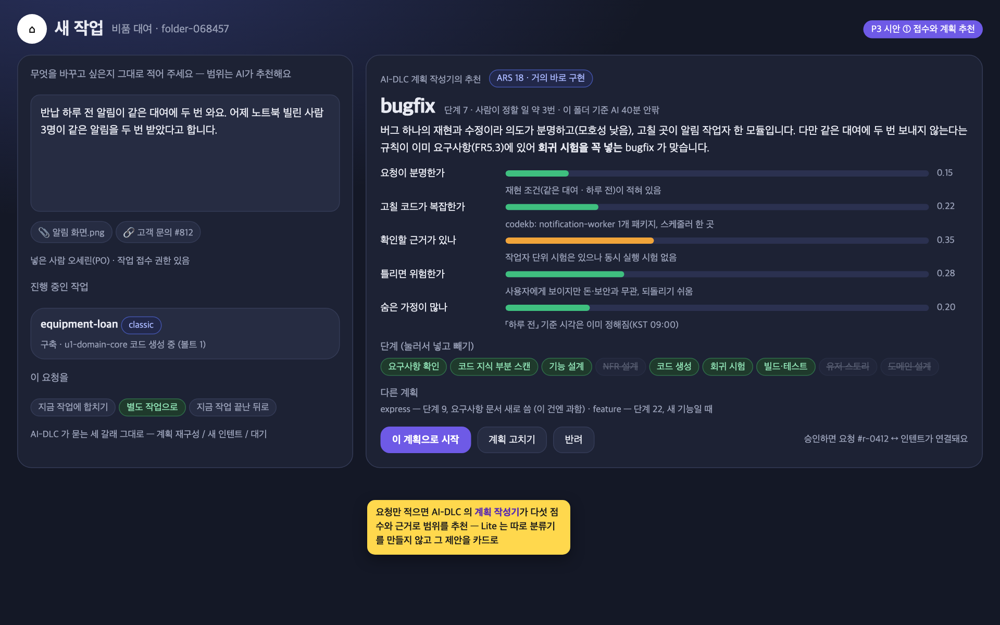
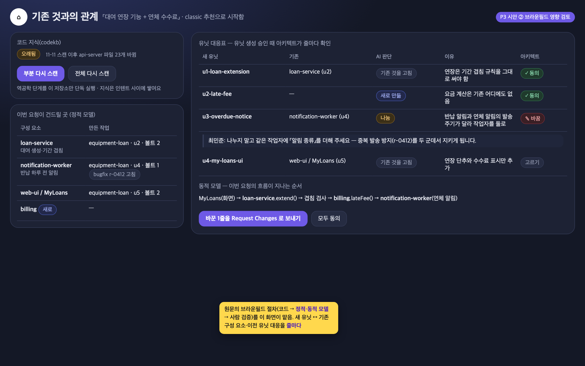
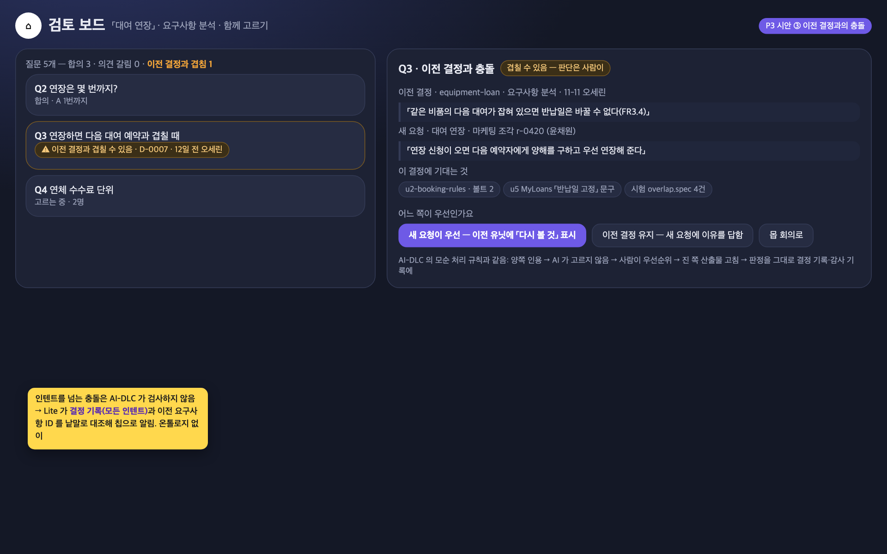
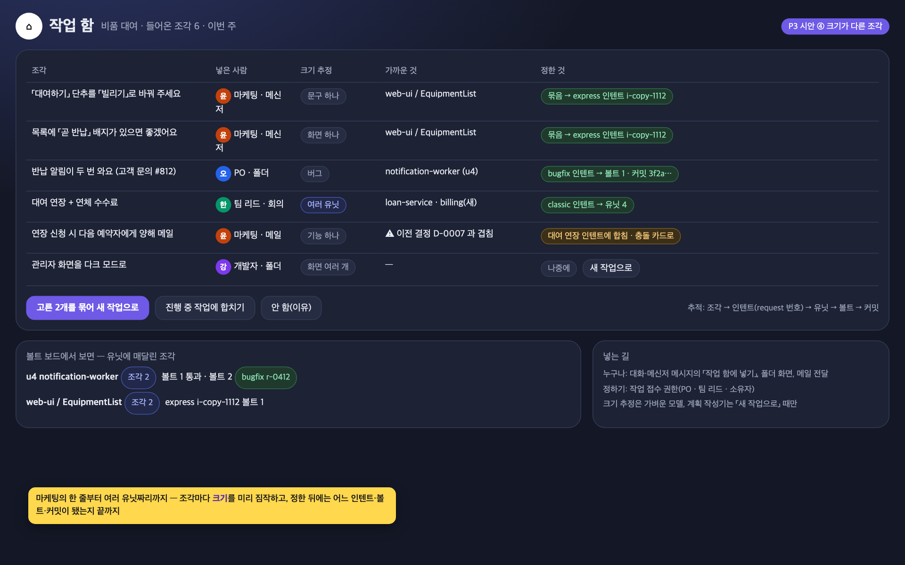
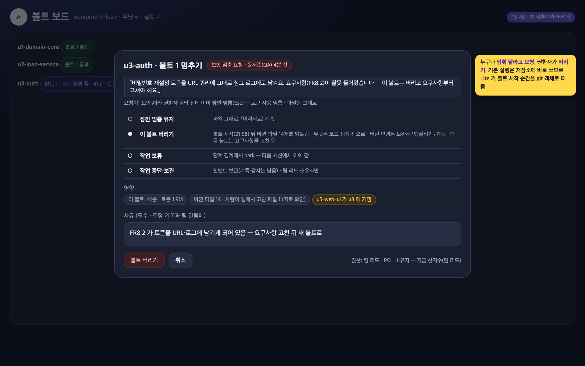
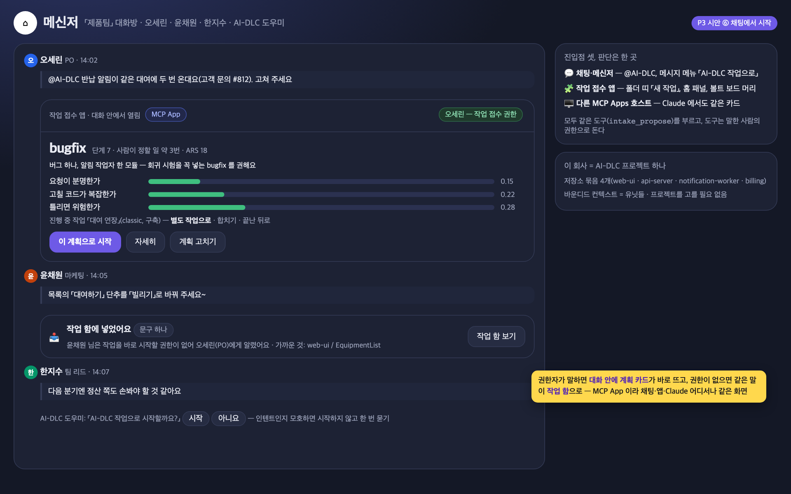
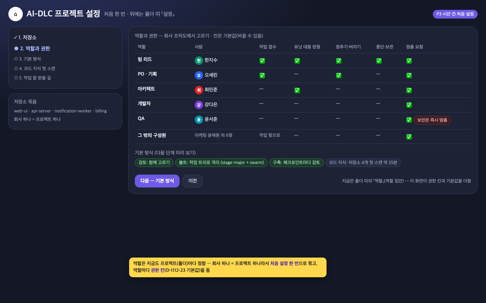
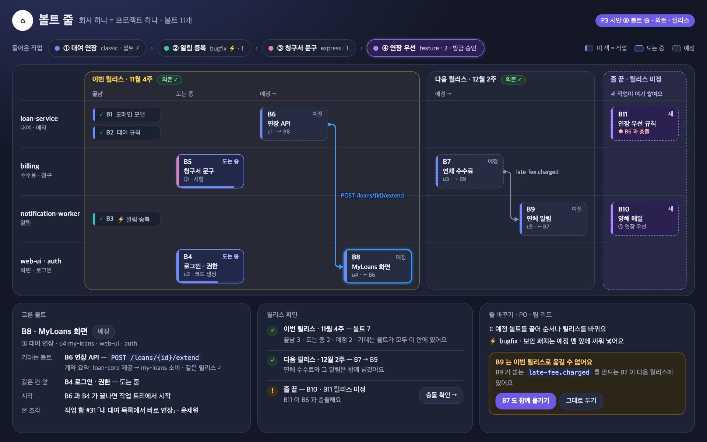
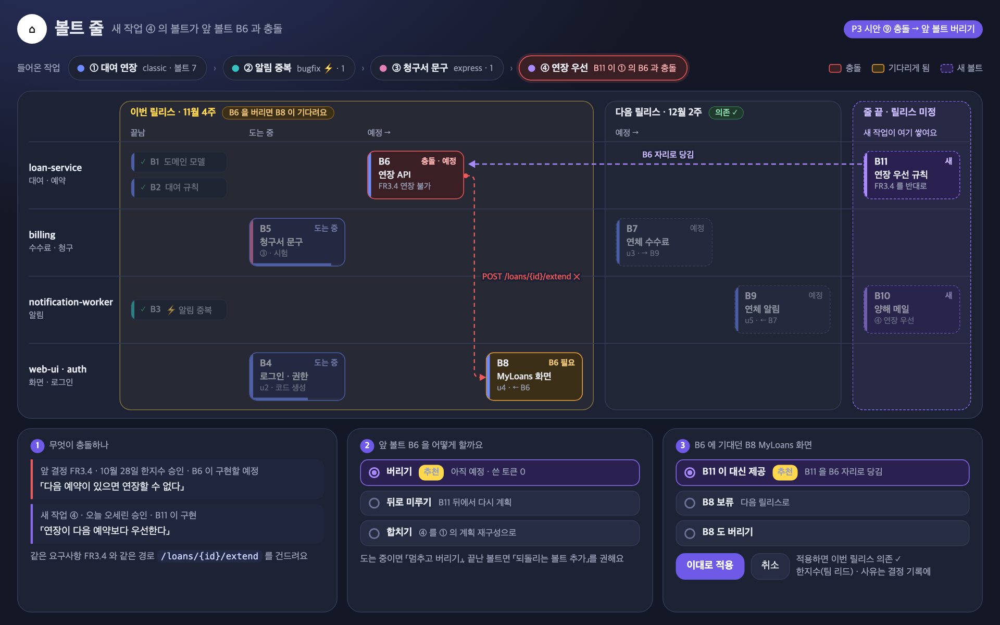

# Robo-DLC Lite P3 설계안 — 작업 접수 · 기존 것과의 관계 · 충돌 · 작은 조각 · 멈추기와 버리기

상태: 설계안. 권한 기본값·보안 멈춤·볼트 격리는 사용자 결정(D-1112-23~26, §11), 진입점(§12)은 검토 대기. 2026-11-12 사용자 요청: "요구사항을 그냥 던지면 버그 픽스·익스프레스·클래식 중 무엇이 좋은지 이유와 함께 추천하고, 브라운필드에서는 기존 유닛과의 관계를 검증하고, 충돌과 작은 조각을 지속적인 개선·유지보수에 쓰기 쉽게, 볼트는 언제든 멈추거나 버릴 수 있게 — 아무나는 아니고 PM 같은 자격 있는 사람이." 온톨로지는 쓰지 않는다(같은 날 판단).

근거: AI-DLC 원문(Raja SP, AWS 2025)·AI-DLC 2026(ai-dlc.dev)·설치본 2.11.2 대조(같은 날 답변). 원문은 인텐트 사이의 병합·충돌·되돌리기를 다루지 않는다. 2.11.2는 일부 기능을 엔진 명령으로 제공하지만 화면은 없다.

시안 그림(정적 HTML `p3-mock/mock.html`, 데이터는 예시):

| ① 접수와 계획 추천 | ② 브라운필드 영향 검토 | ③ 이전 결정과의 충돌 | ④ 작업 함 | ⑤ 멈추기와 버리기 |
|---|---|---|---|---|
|  |  |  |  |  |

## 1. 원칙

1. **판단은 AI-DLC가, 화면은 Lite가.** 범위(scope) 추천은 AI-DLC의 계획 작성기(composer)가 이미 한다. 요청을 다섯 가지 기준으로 점수화하고(아래 §3), 결정적인 도구 `aidlc engine graph ars`로 단계 묶음과 가까운 표준 범위를 계산한다. Lite는 따로 분류기를 만들지 않고, 그 제안을 카드로 보여 주어 사람이 읽고 고르게 한다. 중단(park)·작업 전환(intent)·모순 처리 규칙도 마찬가지다.
2. **온톨로지 없이, 있는 기록으로.** 연결에는 기존 기록을 쓴다: 요청 번호(`intents.json`의 `request`), 결정 기록(`pro_aidlc_decisions`), 요구사항 ID(FR·US), 코드 지식(`codekb/<repo>/component-inventory.md`), 감사 기록, 볼트 = 유닛의 코드 생성 한 번(D-1112-21). 겹침은 낱말·ID·파일 경로 대조로 찾는다.
3. **되돌릴 수 있는 것부터.** 멈추기는 즉시, 버리기는 확인 후, 기록은 항상. 버리기는 그 볼트가 바꾼 것만 되돌리고, 사람이 쓴 것은 건드리지 않는다.
4. **권한은 역할표로.** 이미 있는 역할(팀 리드·PO·아키텍트·개발자·QA)에 「작업 접수」「멈추기·버리기」 권한을 추가한다. 누구나 멈춰 달라고 요청할 수는 있다.

## 2. 지금 어디까지 되어 있나

| 필요한 것 | AI-DLC 2.11.2가 가진 것 | Lite 화면 | 빈 곳 |
|---|---|---|---|
| 새 작업 시작 | `/aidlc "<요청>"`이면 계획을 제안, `/aidlc compose "<요청>"`은 계획 작성기 → 승인·고치기·반려 창 | 「세션 시작」 뒤 쉘에 직접 `/aidlc classic "…"` 입력 | **접수 화면이 없다.** 사람이 범위를 미리 골라 입력해야 한다 |
| 범위 추천과 이유 | 작성기가 다섯 점수(의도 모호성·코드 구조 불확실성·검증 근거 약함·위험·숨은 가정)와 근거, 가까운 표준 범위, 단계 표를 만든다 | 승인 창은 결정 화면에 「Approve / Edit / Reject」로만 보인다 | 점수·이유·대안이 쉘 화면에만 있다 |
| 진행 중에 새 요청 | "지금 일 계속 / 별도 작업 / 계획 재구성"을 묻는다. `/aidlc intent <이름>` 전환, `intent archive` 보관 | 대시보드가 인텐트 목록을 읽는다 | 묻는 창이 결정 화면에 오지만 맥락(어느 인텐트, 어디까지)이 없다. 전환·보관 단추가 없다 |
| 브라운필드·기존 코드 | 역공학(9개 산출물, 인텐트 사이 공유 `codekb`), 신선도 검사 `codekb-scope-diff`, `--project-type brownfield` | 없음 | 코드 지식이 최신인지, 이번 요청이 어느 구성 요소·이전 유닛을 건드리는지 보이지 않는다 |
| 유닛 다시 쪼개기 검증 | 유닛 생성 단계(인텐트마다 새로), 이전 인텐트의 유닛은 읽지 않는다 | 검토 보드·산출물 보기로 유닛 문서 검토 | 새 유닛과 기존 구성 요소·이전 유닛의 대응표가 없다 |
| 충돌 | 같은 인텐트 안: 답변 사이의 모순은 후속 질문. 단계 사이 모순: 양쪽 인용 → 사람이 우선순위 결정 → 우선순위가 낮은 쪽 수정 → 판정을 감사 기록에. 규칙: 좁은 규칙이 넓은 규칙과 부딪히면 거절 | 후속 질문은 검토 보드 카드로 | **이전 인텐트의 결정과의 충돌은 아무도 검사하지 않는다** |
| 크기가 다른 조각 | 범위 11가지(bugfix·express·feature·classic·enterprise …)와 맞춤 계획 | 없음 | 마케팅의 한 줄, 고객 문의 같은 조각을 모아 두고 분류할 곳이 없다 |
| 멈추기 | Claude Code의 Esc(지금 일 중단), `orchestrate park --person-asked`(단계 경계에서 보류) | 세션 끄기(폴더 소유자만) | 중간에 멈추는 단추·권한·사유 기록이 없다 |
| 볼트 버리기 | 병렬(swarm) 구축에서만 볼트가 작업 트리로 격리되어 있어 버릴 수 있다(`worktree restore`로 되살림). 기본(serial)은 저장소에 바로 쓴다 — 실제 실행(회의실 예약)에서도 커밋 없이 작업 폴더에 바로 썼다 | 없음 | 기본 실행에서 볼트 하나만 되돌리는 방법이 없다 |

## 3. 화면 1 — 새 작업 접수와 계획 추천

폴더의 AI-DLC 띠에 **새 작업** 단추. 권한: 작업 접수 권한(기본 PO·팀 리드·폴더 소유자). 다른 사람은 「작업 함」(§6)에 넣는다.

1. 요청을 한 덩어리로 적는다(붙여 넣기, 화면 그림·링크 첨부). 범위는 묻지 않는다.
2. **계획 추천 카드** — Lite가 팀 세션에 `/aidlc compose "<요청>"`을 넣으면 작성기가 제안을 만든다. 카드에 보이는 것:
   - 추천 범위 하나와 한 문단으로 쓴 이유("버그 하나의 재현과 수정이라 의도는 분명하고(모호성 낮음) 고칠 곳이 한 모듈(구조 불확실성 낮음) — bugfix")
   - 다섯 점수 막대: 요청이 분명한가 · 고칠 코드가 복잡한가 · 맞는지 확인할 근거가 있나 · 틀리면 위험한가 · 숨은 가정이 많나. 막대마다 근거 한 줄(작성기가 인용한 근거).
   - 단계 칩(실행/건너뜀)과 대안 둘(예: express — 단계 9, feature — 단계 22)과 차이
   - 예상: 사람이 결정할 횟수, 이 폴더의 지난 실행 기준 AI 작업·사람 대기 시간(대시보드 계산 재사용)
   - **진행 중인 작업과의 관계**(진행 중인 인텐트가 있으면): 「지금 작업에 합치기(계획 재구성)」 / 「별도 작업으로」 / 「지금 작업 끝난 뒤로」 — AI-DLC가 묻는 세 가지 선택지를 카드에서도 고른다
3. **승인 · 계획 고치기 · 반려.** 계획을 고칠 때 단계 칩을 눌러 추가하거나 빼면 `--skip`/`--add`로 전달된다. 승인하면 AI-DLC가 인텐트를 만들고 그 `request` 번호를 접수 기록에 남긴다.

구현 경로: 제안의 점수·근거는 작성기 결과에서 읽는다. 쉘 화면에서 추출하는 대신, 작은 훅을 통해 작성기가 제안을 파일(`aidlc/.aidlc-compose-proposal.json`)로도 남기게 하거나 `aidlc engine graph ars` 출력의 표를 읽는다(확인 필요 §9-1).

## 4. 화면 2 — 기존 것과의 관계(브라운필드 영향 검토)

계획 승인 직후에 보이고, 유닛 생성 승인 때 다시 보인다. 볼 사람: 아키텍트(기본), 팀 리드.

- **코드 지식 상태**: `codekb-scope-diff` 결과를 그대로 — 최신 / 오래됨 / 이번 요청이 스캔 범위 밖. 오래됐으면 「다시 스캔(부분 · 전체)」(역공학 단계 단독 실행).
- **건드릴 곳**: 요청과 요구사항의 낱말을 `component-inventory.md`·`api-documentation.md`와 대조한 구성 요소 목록. 각 구성 요소를 만든 **이전 인텐트·유닛**(이전 인텐트의 유닛 문서·코드 계획에서 같은 경로를 찾음)과 마지막 볼트.
- **유닛 대응표**(유닛 생성 승인 때): 새 유닛 ↔ 기존 구성 요소·이전 유닛, 각 줄에 AI가 붙인 판단 하나 — 「기존 것을 고침」 「새로 만듦」 「나눔(기존 유닛을 둘로)」 「합침」 — 와 이유. 아키텍트가 줄마다 동의하거나 바꾼다. 바꾸면 검토 지적 하나로 묶여 「Request Changes」로 들어간다(검토 보드와 같은 경로).
- 이 화면은 원문의 브라운필드 절차(코드를 정적·동적 모델로 끌어올려 사람이 검증)를 맡는다: 정적 모델 = 구성 요소 목록, 동적 모델 = 이번 요청의 흐름이 지나는 구성 요소 순서.

## 5. 화면 3 — 이전 결정과의 충돌

검토 보드 카드에 붙는 표시와 충돌 카드 하나.

- **찾기**: 새 질문·요구사항이 나오면 이 폴더의 결정 기록(모든 인텐트)과 이전 인텐트 요구사항의 ID·제목을 낱말로 대조한다. 이를 통해 같은 주제의 이전 결정을 찾는다. 찾으면 카드에 「이전 결정과 겹침 · D-… · 3주 전 오세린」 칩.
- **충돌 카드**: 양쪽을 그대로 인용(이전 결정 / 새 요청), 그 결정을 만든 인텐트·단계·사람, 그 결정에 의존하는 것(이후 유닛·볼트). 고를 것: 「새 요청이 우선」 「이전 결정 유지」 「몹 회의로」. AI-DLC의 복구 규칙과 같다: AI가 아닌 사람이 고르고, 판정을 그대로 기록한다(결정 기록 + 감사 기록).
- 새 요청이 우선이면 그 결정에 의존한 이전 유닛이 「다시 볼 것」으로 표시된다(볼트 보드의 유닛 칩). 고치는 일은 새 인텐트의 유닛이 한다(원문·2.11.2 모두 이전 유닛에 덧붙이지 않는다).

## 6. 화면 4 — 작업 함(작은 조각)

마케팅의 한 줄, 고객 문의, 회의 중 나온 개선안 같은 조각을 받는 곳. 누구나 넣는다(대화·메신저의 「작업 함에 넣기」, 폴더 화면, 메일 전달).

- 조각마다 AI가 미리 붙이는 것: 크기 추정(문구 하나 / 화면 하나 / 기능 하나 / 여러 유닛), 관련성이 높은 진행 중 인텐트, 겹치는 이전 결정.
- 접수 권한자가 고른다: 「진행 중 작업에 합치기」 「새 작업으로(계획 추천 카드로)」 「여러 조각을 묶어 새 작업 하나로」 「나중에」 「안 함(이유)」.
- **추적**: 조각 → 인텐트(`request` 번호) → 유닛 → 볼트 → 커밋. 볼트 보드 위쪽에 인텐트 고르기(폴더에 인텐트가 여럿일 때)와 유닛 칩에 「조각 3개」 같은 표시. 조각을 누르면 처음 넣은 사람과 원문.
- 저장: Lite 표 `pro_aidlc_requests`(폴더, 넣은 사람, 원문, 출처, 크기 추정, 상태, 인텐트 slug, request 번호).

## 7. 화면 5 — 멈추기와 버리기

볼트 보드에서 현재 실행 중인 유닛, 세션 보기, 결정 화면에 **멈추기** 단추.

| 하는 일 | 무엇이 일어나나 | 누가 | 되돌리기 |
|---|---|---|---|
| 잠깐 멈춤 | 세션에 Esc — 진행 중인 생성과 토큰 사용이 즉시 멈춘다. 파일은 그대로 | 멈추기 권한(기본 팀 리드·PO·소유자) | 「이어서」 |
| 볼트 버리기 | 잠깐 멈춤 + 이 볼트가 시작된 뒤 바뀐 파일을 볼트 시작 시점으로 되돌림, 유닛은 코드 생성 전으로 → 다음 볼트로 다시(요구사항을 고친 뒤) | 같음 + 사유 필수 | 버린 변경은 보관 ref에 남아 「되살리기」 가능 |
| 작업 보류 | 단계 경계에서 `park --person-asked`. 다음 세션에서 이어 감 | 같음 | 「이어서」 |
| 작업 중단·보관 | 인텐트 보관(`intent archive`) — 기록·감사는 남고 목록에서 숨김 | 팀 리드·소유자 | 「보관 풀기」 |
| 멈춰 달라고 요청 | 이유(보안 문제·말이 안 되는 요구 등)를 적으면 권한자에게 **긴급 카드**. 「보안」이면 권한자 응답을 기다리지 않고 바로 잠깐 멈춤 | 구성원 누구나 | — |

- **볼트는 작업 트리로 격리한다(D-1112-25).** AI-DLC 2.11.2는 병렬(swarm) 구축 경로에서 볼트마다 작업 트리와 가지를 만든다. 승인되면 볼트 이름의 커밋 하나로 main에 squash merge한다(`org.md` Way of Working). 기본 직렬(serial) 실행만 저장소에 바로 쓴다. Lite의 AI-DLC 폴더는 처음 설정할 때 구축 방식을 `stage-major` + `swarm`으로 둔다(`aidlc engine state set-construction-iteration stage-major`, `… set-construction-execution swarm`). 그러면 볼트 버리기는 AI-DLC의 작업 트리 버리기를 그대로 따른다(`worktree restore --slug`로 되살림). main에는 승인된 볼트만 반영된다.
- 이미 직렬로 시작한 작업에서만 Lite가 감사 기록에서 코드 생성 시작을 확인하는 즉시 작업 폴더를 git 객체로 저장해 둔다(`git stash create` + `refs/lite/bolts/<유닛>/<n>`, 작업 폴더는 건드리지 않음). 버릴 때는 그 볼트가 바꾼 파일만 되돌린다. 사람이 쉘에서 고친 파일과 겹치면 목록을 보여 주고 확인을 받는다.
- **보안 멈춤 요청은 바로 멈춘다(D-1112-24).** 「보안」으로 표시한 요청이 들어오면 권한자 응답을 기다리지 않고 잠깐 멈춤(Esc)을 보낸다. 버리기·보류는 그 뒤 권한자가 정한다.
- 대화상자에 보이는 것: 이 볼트가 지금까지 쓴 시간·토큰(세션 비용), 바뀐 파일 수, 영향(이 유닛에 의존하는 다른 유닛). 모든 멈추기·버리기는 사람·사유와 함께 결정 기록에 남기고 팀에 알린다.
- 볼트 보드: 버린 볼트는 「버림 · 사유」로 남는다(되돌아옴과 구별).

## 8. 권한(역할표에 얹음) — 사용자 확인(D-1112-23)

| 권한 | 기본 | 비고 |
|---|---|---|
| 작업 접수(새 작업·계획 승인) | PO, 팀 리드, 소유자 | 작업 함 넣기는 누구나 |
| 영향 검토 판정(유닛 대응표) | 아키텍트, 팀 리드 | 바꾸면 Request Changes |
| 충돌 판정 | 그 단계 결정권자 | 몹 회의로 넘길 수 있음 |
| 멈추기·버리기·보류 | 팀 리드, PO, 소유자 | 사유 필수, 기록·알림 |
| 작업 중단·보관 | 팀 리드, 소유자 | |
| 멈춰 달라는 요청 | 구성원 누구나 | 「보안」은 즉시 잠깐 멈춤(D-1112-24) |

## 9. 확인할 것 · 위험

1. 작성기 제안을 기계로 읽는 방법: 2.11.2의 작성기 결과가 대화에만 있으면, 화면 문구 변경 시 읽기에 실패한다. 제안을 파일로 남기는 훅을 프로젝트 쪽에 둘 수 있는지 확인(분류기·권한 규칙상 `.claude/` 쓰기는 사람이 승인해야 할 수 있음).
2. Esc로 도구 실행을 중단할 때 남는 작성 중인 파일 — 볼트 버리기와 같이 되돌리기 목록에 넣는다.
3. 작성기 한 번은 하위 에이전트 한 번이다(토큰). 작업 함의 크기 추정은 작성기가 아니라 가벼운 모델로 하고, 승인 직전에만 작성기를 부른다.
4. 이전 결정은 낱말로 대조하므로 충돌을 놓치거나 잘못 찾을 수 있다 — 칩은 「겹칠 수 있음」으로 쓰고 판단은 사람이.

## 10. 단계

- **P3a**(먼저): 새 작업 접수 + 계획 추천 카드, 진행 중 작업과의 관계, 멈추기·볼트 버리기·보류와 권한. 시나리오: 「비품 대여」 실행 중 버그 하나(bugfix 추천) · 큰 기능 하나(classic 추천) 접수, 코드 생성 중 「보안」 멈춤 요청 → 권한자가 볼트 버리기 → 요구사항을 고친 뒤 다음 볼트.
- **P3b**: 영향 검토(코드 지식 상태·건드릴 곳·유닛 대응표), 이전 결정 충돌 카드.
- **P3c**: 작업 함과 조각 추적, 볼트 보드의 인텐트 고르기.
- **P3d**: 볼트 줄(§13) — 인텐트를 줄 뒤에 쌓기, 빠른 칸·순서 바꾸기·릴리스 선, 새 인텐트와 충돌하는 앞 볼트를 버리도록 권유.

## 11. 사용자 결정 (2026-11-12)

- 권한 기본값(§8): 그대로 — D-1112-23.
- 「보안」 멈춤 요청: 권한자 응답 전에 바로 멈춘다 — D-1112-24.
- 볼트 격리: 볼트는 작업 트리로 격리한다(AI-DLC 병렬 경로) — D-1112-25. 원문(AWS 2025)은 git·작업 트리를 언급하지 않는다. AI-DLC 2026은 유닛마다 가지(`ai-dlc/<intent>/<NN-unit>`)를 둔다.
- 범위: 회사 하나 = AI-DLC 프로젝트 하나(여러 바운디드 컨텍스트를 가진 한 기업), 권한 있는 사람이 채팅에서 시작 — D-1112-26. 진입점 설계는 §12.
- 남은 것: 작업 함에 들어오는 길(§12-4에 제안).

## 12. 진입점 — 어디서 어떻게 시작하나

전제(D-1112-26): 회사 하나가 AI-DLC 프로젝트 하나다. 여러 바운디드 컨텍스트(유닛들)를 가진 한 기업의 저장소 묶음을 Lite 폴더 하나로 연결한다. 저장소가 여러 개면 AI-DLC의 저장소 묶음(repo set)으로 등록한다. 코드 지식은 저장소마다 쌓인다. 프로젝트가 하나이므로 시작할 때 프로젝트를 고를 필요가 없다.

| ⑥ 채팅에서 시작 | ⑦ 처음 설정 |
|---|---|
|  |  |

### 12-1. 처음 한 번 — AI-DLC 프로젝트 설정

현재는 폴더 화면의 AI-DLC 띠 → 「역할」에서 폴더(= 프로젝트)마다 역할을 정한다(`pro_aidlc_roles`). 회사 하나 = 프로젝트 하나이므로 역할 설정을 **처음 설정**으로 묶는다. 저장소를 AI-DLC 폴더로 연결하면 한 번 표시되고, 이후에는 띠의 「설정」에서 연다.

1. 저장소(여러 개면 묶음)와 이름
2. 구성원과 역할 — 회사 조직도(팀 구성원)에서 고른다. 역할마다 권한 칸(§8 표)이 기본값에 따라 켜져 있다
3. 기본 방식 — 검토는 「함께 고르기」, 구축은 볼트마다 작업 트리(`stage-major` + `swarm`), 구축 자동 진행은 「체크포인트마다 검토」
4. 기존 코드가 있으면 코드 지식 첫 스캔(역공학 단독 실행)과 소요 시간
5. 작업 함으로 요청을 받을 경로(§12-4)

### 12-2. 채팅에서 시작 (주 진입점)

- **어디서**: Lite의 대화(채팅)와 메신저 대화방. 대화방에서는 도우미를 부르거나(@AI-DLC) 메시지 메뉴에서 「AI-DLC 작업으로」 선택.
- **어떻게**: 작업 접수 앱의 도구(`intake_propose`)를 채팅 에이전트(`server/lib/agent.js`)와 대화방 도우미(`teamAssist`)에 노출한다. 인텐트로 보이는 말("대여 연장 기능 넣자", "알림이 두 번 와요")이면 에이전트가 이 도구를 호출한다. 도구의 `ui://` 화면(§3 계획 추천 카드)이 **대화 안에 그대로** 뜬다. MCP Apps이므로 Claude 같은 다른 호스트에서도 같은 카드가 뜬다.
- **권한**: 도구는 요청한 사람의 권한으로 실행된다. 작업 접수 권한이 있으면 카드에서 「이 계획으로 시작」 → 팀 세션에 `/aidlc compose …` 승인 → 인텐트 생성. 권한이 없으면 같은 카드가 「작업 함에 넣었어요 — 오세린(PO)에게 알렸어요」로 바뀌고 요청은 조각으로 들어간다.
- **진행 중 작업이 있으면** 카드가 「합치기 / 별도 작업 / 끝난 뒤로」를 묻는다(§3).
- **애매하면 묻는다**: 인텐트인지 단순한 질문인지 모호하면 에이전트는 작업을 시작하지 않고 「AI-DLC 작업으로 시작할까요?」 한 줄을 붙인다. 잘못 시작해 토큰을 쓰는 것보다 한 번 묻는 편이 비용이 적게 든다.

### 12-3. 앱에서 시작 — 「작업 접수」 앱 (MCP App)

검토 보드·볼트 보드처럼 앱 하나 = MCP 서버 하나(`server/apps/intake`, `ui://intake/view`).

| 도구 | 하는 일 | 보이는 곳 |
|---|---|---|
| `intake_open` | 접수 화면: 요청 입력, 진행 중 작업, 작업 함 | 폴더 띠 「새 작업」, 홈 패널, 볼트 보드 상단 |
| `intake_propose` | 요청 → 계획 작성기 제안(§3 카드) | 채팅·대화방 안, 접수 화면 |
| `intake_start` | 승인 → 인텐트 생성(권한자) | 카드의 「이 계획으로 시작」 |
| `inbox_add` · `inbox_triage` | 작업 함에 넣기·처리 방향 정하기(§6) | 메시지 메뉴, 접수 화면 |
| `work_stop` | 멈춤·버리기·보류·보관(§7) | 볼트 보드, 세션 보기, 결정 화면 |

같은 도구를 채팅에서 호출하면 대화 안에 화면이 뜨고, 단추로 열면 앱 화면으로 뜬다. 진입점이 여럿이어도 판단·권한·기록은 한 곳(앱 서버)에서 처리한다.

### 12-4. 작업 함에 들어오는 길(제안)

1단계는 Lite 내부 경로만 사용: 대화·메신저 메시지 메뉴의 「작업 함에 넣기」, 채팅에서 작업 접수 권한이 없는 사람의 요청(자동), 접수 화면. 메일 전달(Lite 메일함에서 이미 하는 「메일로 온 …」 처리 재사용)은 2단계.

### 12-5. 진입점 시나리오(P3a 시험·녹화)

1. 처음 설정: 저장소 연결 → 조직도에서 역할 설정 → 기본값(함께 고르기·작업 트리) → 코드 지식 첫 스캔.
2. 오세린(PO)이 메신저 대화방에서 "반납 알림이 두 번 온대요, 고쳐 주세요" → 대화 안에 bugfix 추천 카드 → 시작.
3. 윤채원(마케팅, 권한 없음)이 채팅에서 "「대여하기」 단추를 「빌리기」로" → 작업 함에 들어가고 오세린에게 알림.
4. 한지수(팀 리드)가 폴더의 「새 작업」에서 큰 기능(classic 추천) 시작 → 볼트가 작업 트리에서 실행된다.
5. 윤서준(QA)이 「보안」 멈춤 요청 → 바로 멈춤 → 한지수가 볼트 버리기 → main은 그대로.

## 13. 볼트 줄 — 인텐트가 쌓이는 곳 (D-1112-27)

원문·AI-DLC 2026·2.11.2는 모두 인텐트 하나 **안의** 볼트 순서를 정한다(볼트 계획: 순서·완료 기준·보여 줄 결과, 2.11.2는 팀 배정과 순서 이유까지). 여러 인텐트를 어느 순서로 어느 릴리스에 담을지는 정하지 않는다. 따라서 Lite는 프로젝트(= 회사) 하나에 **볼트 줄** 하나를 둔다.

### 13-1. 구조

- 줄은 릴리스 묶음 셋으로 나뉜다: 「이번 릴리스」(끝남 | 도는 중 | 예정), 「다음 릴리스」, 「줄 끝 · 릴리스 미정」. 인텐트의 계획을 승인하면 해당 볼트 계획의 볼트들이 **줄 끝에 예정으로 붙는다**. 인텐트가 쌓이면 볼트도 줄 뒤에 쌓인다. 볼트의 띠 색은 인텐트를, 테두리는 상태(실선 = 도는 중, 점선 = 예정)를 나타낸다.
- 줄의 칸은 바운디드 컨텍스트(유닛이 건드리는 구성 요소)별로 나눈다. 의존 관계가 없고 서로 다른 칸에 있는 볼트는 작업 트리에서 병렬로 실행된다(D-1112-25). 같은 칸에서는 앞 볼트가 끝나야 다음 볼트가 시작된다.
- 예정 볼트에는 인텐트·유닛·완료 기준과 해당 인텐트를 만든 조각(작업 함)이 연결된다.
- **빠른 칸**: bugfix·security-patch 범위의 인텐트는 권한자가 줄 앞에 끼워 넣을 수 있다. 「보안」 멈춤(D-1112-24)과 함께 쓴다.
- **순서 바꾸기·릴리스 묶음**: 작업 접수 권한자(PO·팀 리드)가 예정 볼트를 끌어 순서를 바꾸거나 다른 릴리스 묶음으로 옮긴다. 의존 그래프에 어긋나는 이동은 막는다.

### 13-2. 새 인텐트가 앞 볼트와 충돌할 때 — 버리기를 권한다

화면은 세 걸음이다: ① 무엇이 충돌하나(앞 결정과 새 요청을 나란히) → ② 앞 볼트를 어떻게 할까 → ③ 그 볼트에 기대던 볼트를 어떻게 할까. 줄에서는 충돌한 볼트(빨강), 기다리게 되는 볼트(주황), 새 볼트(보라)만 밝게 보인다.

새 인텐트를 승인하면(§3 카드의 「이 계획으로 시작」) Lite가 해당 인텐트의 유닛·구성 요소·요구사항을 줄에 있는 다른 볼트와 대조한다(§5와 같은 낱말·ID·경로 대조). 겹치는 앞 볼트가 있으면 카드에 충돌 줄을 표시한다. 볼트 상태에 맞는 처리도 권한다.

| 앞 볼트 상태 | 권하는 처리 | 비용 |
|---|---|---|
| 예정(아직 안 돎) | **버리기** — 줄에서 뺀다. 계획 재구성으로 해당 인텐트의 남은 계획에서 그 유닛을 빼거나 고친다 | 토큰 0 |
| 도는 중 | **멈추고 버리기** — 작업 트리째 버린다(§7). 다시 실행할지는 새 인텐트 뒤에서 정한다 | 그때까지 쓴 토큰만 |
| 끝남(main에 합쳐짐) | 버릴 수 없다 — **되돌리는 볼트**를 새 인텐트의 첫 볼트로 붙인다(그 볼트의 squash 커밋 revert + 시험) | 볼트 하나 |
| 겹치지만 함께 갈 수 있음 | **뒤로 미루기** 또는 **합치기**(새 요청을 그 인텐트의 계획 재구성으로) | — |

- 판단은 사람이 한다(§5와 같다). 권한자(멈추기·버리기 권한, D-1112-23)가 고르면 그 판단이 사유와 함께 결정 기록에 남는다. 버린 볼트는 줄에 「버림 · 사유 · 대신한 인텐트」로 남는다.
- 버린 예정 볼트의 조각은 작업 함으로 돌아가고, 넣은 사람에게 알림을 보낸다.

### 13-3. AI-DLC 와 맞물리는 법

- AI-DLC 2.11.2의 세션은 한 번에 인텐트 하나를 진행한다(사람·클론마다 현재 인텐트). 줄의 다음 볼트가 다른 인텐트에 속하면 Lite는 팀 세션에서 `/aidlc intent <이름>`으로 전환해 이어 간다. 또는 다른 칸의 볼트를 병렬로 실행할 때 인텐트마다 세션(작업 트리)을 따로 띄운다 — 확인 필요(동시 세션 두 개가 같은 저장소의 감사 기록·상태를 건드리는 방식).
- 예정 볼트 빼기는 AI-DLC에서 해당 인텐트의 계획 재구성(`next compose` 또는 `--skip`) 또는 유닛 생성 단계의 수정 요청으로 처리한다. Lite는 해당 명령을 대신 입력하고 결과를 줄에 반영한다.
- 줄은 Lite의 표(`pro_aidlc_line`: 프로젝트, 인텐트, 유닛, 볼트 번호, 칸, 순서, 상태, 릴리스 표시, 버린 사유)로 둔다. 볼트 보드(의도 → 유닛 → 볼트)는 인텐트 하나를, 볼트 줄은 프로젝트 전체를 보여 준다.

### 13-4. 볼트 의존과 릴리스 시점

한 볼트가 구현하는 스펙(API·이벤트 계약)을 다른 유닛의 볼트가 사용하면, 사용하는 볼트는 앞 볼트 없이는 실행하거나 릴리스할 수 없다. 줄에서는 이 의존 관계를 화살표로 표시한다.

- **의존을 어디서 읽나**(새로 그리지 않는다):
  - 인텐트 안: 유닛 의존 문서(`unit-of-work-dependency.md`의 `units` / `depends_on`)와 계약 설계의 계약 요약(`contract-summary`)의 제공 유닛 → 소비 유닛.
  - 인텐트 사이: 새 인텐트의 계약 요약·요구사항에 나오는 계약 이름(엔드포인트·이벤트 이름)을 줄에 있는 이전 인텐트의 계약 요약·코드 지식의 `api-documentation.md`와 대조. 이미 끝난(main에 합쳐진) 볼트가 계약을 제공하면 의존 조건이 충족된 것으로 본다.
- **줄에서 지키는 것**:
  - 볼트는 의존하는 볼트가 끝나야 시작된다(AI-DLC의 실행 묶음 계산과 같은 규칙을 인텐트 사이로 확장한 것).
  - 순서를 바꿀 때 의존 관계에 어긋나면 막고, 이유(「B9 가 B7 의 POST /loans/{id}/extend 를 씀」)를 보여 준다.
- **릴리스 시점**: 「이번 릴리스」 선 안에 포함된 볼트가 의존하는 볼트도 같은 릴리스나 이전 릴리스에 있어야 한다. 의존하는 볼트가 빠지면 선 위에 「B9 를 넣으려면 B7 도 필요해요」를 표시한다. 함께 넣거나 B9를 다음 릴리스로 미루게 한다. 릴리스마다 「의존이 모두 끝났나」를 한 줄로 표시한다.
- **버리기와 의존**: 볼트를 버리면(§13-2) 해당 볼트에 의존하는 볼트들이 함께 표시된다 — 「B7 을 버리면 B9·B11 이 기다리게 돼요」. 고를 것: 의존하는 볼트도 버림 / 보류(다른 제공자가 생길 때까지) / 새 인텐트가 같은 계약을 제공하도록 연결.
- 계약 이름은 낱말·경로로 대조하므로 의존 관계를 놓칠 수 있다. 화살표는 아키텍트가 유닛 대응표(§4)에서 확인·수정한다.
