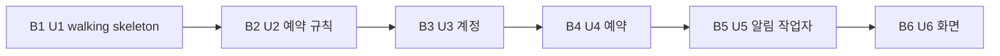

# Bolt 계획 — 팀 회의실 예약

**Bolt**는 작업 한 조각을 설계부터 코드까지 한 번 지나가는 빌드 회차다. 끝나면 실제로 돌아가는 무언가가 남는다.

## 근거 문서

- `inception/units-generation/unit-of-work.md`, `unit-of-work-dependency.md`, `unit-of-work-story-map.md`: 작업 단위 U1–U6과 의존 관계
- `inception/contract-design/contract-summary.md`: 계약 C1–C7
- `inception/user-stories/stories.md`, `inception/requirements-analysis/requirements.md`: 스토리와 요구사항
- `inception/refined-mockups/mockups.md`: 화면 S1–S5
- `inception/domain-design/components.md`: 구성 요소
- `inception/practices-discovery/team-practices.md`: walking skeleton, 트렁크 기반 squash 병합, Vitest, 패키지별 커버리지 80%, GitHub Actions
- `delivery-planning-questions.md`: Q1–Q6

## 계획의 원칙

- **크기**: 작업 단위 하나가 Bolt 하나다. Bolt는 모두 6개다(Q3).
- **진행**: 한 번에 하나씩 만든다. 앞 Bolt를 `main`에 squash 병합한 뒤 다음 Bolt를 시작한다(Q4).
- **순서**: U1 다음은 위험한 것부터다(Q1). 가장 걱정되는 "동시 예약 겹침 차단"(Q6)은 U1에서 처음 확인하고, U4에서 완성한다.
- **브랜치**: 각 Bolt는 `main`에서 갈라진 짧은 브랜치에서 진행한다. 끝나면 Bolt 이름으로 된 커밋 하나로 `main`에 squash 병합한다(`team-practices.md` Way of Working).
- **모든 Bolt의 공통 완료 조건**:
  - GitHub Actions 검사(설치·린트·테스트)가 통과한다.
  - 해당 패키지의 라인 커버리지가 80% 이상이다.
  - 사람이 승인한 검증 명령이 통과한다.

## 순서

<!-- Text fallback: B1(U1 walking skeleton) → B2(U2 예약 규칙) → B3(U3 계정) → B4(U4 예약) → B5(U5 알림 작업자) → B6(U6 화면). 한 번에 하나씩 진행한다. -->

---

## B1 — U1 `u1-walking-skeleton` ⟨walking skeleton⟩

- **포함 단위**: U1
- **walking skeleton**: 그렇다. 처음부터 끝까지 실제로 이어지는 가장 작은 통합 조각이다. 이 조각으로 다음을 증명한다.
  - 저장소 뼈대(npm workspaces 네 패키지, ESLint·Prettier, Vitest)가 선다.
  - docker compose의 PostgreSQL과 로컬 메일 확인 도구가 뜬다.
  - `npm run dev` 하나로 `web`·`api`·`worker`가 함께 뜨고, 셋이 같은 저장소를 쓴다.
  - 세션 쿠키 로그인, CSRF 이중 제출, 계약 C1·C2의 첫 판 주소가 동작한다.
  - 작업자가 API와 따로 돌면서 알림 대상을 찾는다.
- **완료 조건**:
  - 저장소 뼈대, docker compose, 마이그레이션 첫 판, 초기 데이터(회의실 3개, 시험 계정 1개), 작업자 읽기 전용 DB 역할이 준비되어 있다.
  - 시험 계정 로그인(`POST /api/v1/auth/login`, `GET /auth/me`, `/auth/csrf`)이 동작한다.
  - 회의실 목록(`GET /rooms`)과 날짜별 예약(`GET /bookings`) 최소판이 동작한다.
  - 예약 생성(`POST /bookings`) 최소판이 동작한다. `Idempotency-Key`는 받지만 아직 저장하지 않는다.
  - 같은 회의실에서 시간이 겹치는 예약은 저장소 제약 최소판과 함께 409 `OVERLAP`으로 거절한다.
  - 화면 최소판이 있다: 로그인 화면, 회의실과 그날 예약을 보여 주는 단순한 표, 예약 양식.
  - 작업자는 30초마다 "10분 안에 시작하는 취소되지 않은 예약"을 찾아 예약 ID를 구조화 로그로 남긴다.
  - GitHub Actions 최소 검사가 있다.
  - **Q6 반영**: 같은 회의실·같은 시간에 예약 요청 2개를 동시에 보내면 정확히 하나만 성공하는지 시험한다. 이 시험은 Vitest로 docker의 PostgreSQL에 대해 실행한다.
- **확인할 가설**:
  - 네 패키지와 세 프로세스, 저장소가 연결되어 한 흐름으로 돈다.
  - 저장소 제약만으로 동시 예약 겹침이 막힌다.
  - 이것이 틀리면 U4 설계(ADR-004)를 U2 전에 다시 본다.
- **시연**:
  1. `docker compose up -d`와 `npm run dev`로 띄운다.
  2. 브라우저에서 시험 계정으로 로그인한다.
  3. 회의실 목록을 본다.
  4. 지금부터 15분 뒤에 시작하는 예약을 만든다.
  5. 같은 시간을 한 번 더 예약해 겹침 거절을 본다.
  6. 5분 안에 작업자 로그에 그 예약 ID가 찍히는 것을 본다.
- **검증**: 사람이 승인한 Construction 검증 명령(아래 "검증 명령")으로 확인하고, 사람의 skeleton 체크포인트 승인을 받는다. 승인 전에는 B2를 시작하지 않는다(`team-practices.md` Walking Skeleton).

## B2 — U2 `u2-booking-rules`

- **포함 단위**: U2
- **완료 조건**: `shared/rules`(계약 C3)의 함수가 모두 있다.
  - `validateTimeRange`, `overlaps`, `findConflicts`, `slotsForDate`, `messageFor`
  - 모든 판단은 KST 기준이다.
  - 경계값 단위 테스트를 포함한다: 끝 = 다음 시작, 부분 겹침, 완전 포함, 감쌈, 07:30, 20:00, 4시간, 4시간 30분, 지금과 같은 시작.
  - `shared` 패키지의 라인 커버리지가 80% 이상이다.
  - `shared/readers` 진입점을 나누는 ESLint 규칙(`web`이 가져오지 못하게 막음)이 적용되어 있다.
- **확인할 가설**: 화면과 서버가 같은 규칙 코드와 문장을 쓸 수 있다. 위반이 여러 개일 때 어떤 코드를 먼저 낼지 정한 순서가 결정적으로 동작한다.
- **시연**: 경계값 테스트 표가 모두 통과하는 결과를 보여 준다.

## B3 — U3 `u3-identity`

- **포함 단위**: U3
- **완료 조건**: 계약 C1 전체가 동작한다.
  - 가입과 로그인 실패 시 같은 응답
  - 연속 5번 실패 시 15분 잠금(가입하지 않은 이메일 포함)
  - 로그아웃과 세션 만료
  - CSRF 확인
  - 계약 C4 `shared/readers/identity`
  - 로그인 실패·잠금을 구조화 로그로 남긴다. 비밀 값은 남기지 않는다.
  - 비밀번호는 느린 해시로만 저장한다.
  - `api` 패키지의 라인 커버리지가 80% 이상이다.
- **확인할 가설**: 잠금 응답을 보고 가입 여부를 알아낼 수 없다. 로그아웃하면 이전 세션이 즉시 401이 된다.
- **시연**: 가입 → 로그아웃 → 틀린 비밀번호 5번 → 잠금 응답 → 시계를 고정해 15분 뒤 로그인 성공.

## B4 — U4 `u4-booking`

- **포함 단위**: U4
- **완료 조건**: 계약 C2 전체와 C5가 동작한다.
  - U2 규칙을 서버에서 적용한다.
  - 저장소 겹침 금지 제약을 완성한다.
  - `Idempotency-Key`를 저장하고 재생한다. 사용자 단위로 고유하고, 같은 키에 내용이 다르면 422를 준다.
  - 취소는 본인만, 시작 전에만 할 수 있다.
  - 날짜별 현황에 `mine`과 `cancellable`을 넣는다.
  - 알림 후보 조회와 유효성·회의실 조회(C5)를 제공한다.
  - 예약 생성·거절 사유·취소를 구조화 로그로 남긴다.
  - **Q6 반영**: 부분적으로 겹치는 요청 10개를 동시에 보내는 시험(AC3.4.2)과 저장소 직접 삽입 거절 시험(AC3.4.3)을 포함한다.
- **확인할 가설**: 겹침 금지가 애플리케이션 검사와 저장소 제약 두 층에서 어긋나지 않는다. 더블 클릭 재전송에 겹침 오류가 보이지 않는다.
- **시연**: API로 같은 시간대 동시 요청 10개를 보낸 뒤 저장된 예약에 겹침이 0쌍임을 확인한다. 같은 키 재전송 시 201로 같은 예약이 돌아오고, 남의 예약 취소는 403이 된다.

## B5 — U5 `u5-notification-worker`

- **포함 단위**: U5
- **완료 조건**: 계약 C5·C6·C7(작업자 권한)이 동작한다.
  - 발송 기록과 행 잠금
  - 예약자 이메일 발송(로컬 메일 확인 도구로 수신)
  - 발송 직전 취소 확인
  - 회의 시작 전까지 재시도
  - 시작 후 "발송 실패" 마감, 응답 불확실 표시
  - 저장소·메일 서버 재연결
  - 작업자 DB 역할로 비밀번호 해시를 읽지 못한다는 확인
  - `worker` 패키지의 라인 커버리지가 80% 이상이다.
- **확인할 가설**: 정상 경우, 재시작, 작업자가 둘인 경우 모두 알림은 정확히 한 통이다. API가 꺼져 있어도 알림은 나간다.
- **시연**:
  - 시계를 고정한 테스트로 09:50 발송, 재시작 후에도 한 통, 작업자 둘이어도 한 통을 확인한다.
  - 실제로 띄운 상태에서 15분 뒤 예약을 만들고 5분 뒤 메일 확인 도구에 메일 한 통이 도착하는 것을 본다.

## B6 — U6 `u6-web-ui`

- **포함 단위**: U6
- **완료 조건**: 화면 S1–S5를 시안과 상호작용 명세대로 만든다.
  - 날짜 바와 30분 칸 타임라인
  - "내 예약" 표시
  - 예약 양식 모달(요청 식별자, 거절 후 입력값 유지)
  - 취소 확인 모달과 위쪽 알림
  - 다섯 가지 화면 상태
  - 태블릿·휴대폰 배치
  - 디자인 토큰
  - WCAG 2.1 AA 점검표의 부품 테스트 항목
  - `web` 패키지의 라인 커버리지가 80% 이상이다.
  - 화면 시안 검토에서 위험으로 남긴 항목(30분 블록의 표시, 요청 식별자를 바꾸는 시점, 1024px 경계, `now` 갱신)은 이 Bolt의 Functional Design에서 정하고 반영한다.
- **확인할 가설**: 키보드만으로 로그인 → 날짜 선택 → 빈 칸 예약 → 취소까지 할 수 있다. 거절된 뒤에도 입력값이 남는다.
- **시연**:
  1. 키보드만으로 위 흐름을 처음부터 끝까지 한다.
  2. 같은 시간 재예약 → 겹침 오류 표시 → 시간만 고쳐 저장한다.
  3. 휴대폰 너비에서 같은 흐름을 한다.

---

## 검증 명령

모든 Bolt의 체크포인트에서 같은 명령 하나를 쓴다. 명령은 Construction에 들어가기 전에 사람이 승인한다. 저장소에 아직 코드가 없으므로, 명령이 실제로 하는 일은 B1이 루트 `package.json`의 `verify` 스크립트로 만든다. 명령이 하는 일은 다음과 같다.

- docker compose로 PostgreSQL과 메일 확인 도구를 띄운다(이미 떠 있으면 그대로 둔다).
- 마이그레이션과 초기 데이터를 넣는다.
- 린트를 돌린다.
- 모든 패키지의 Vitest 테스트를 커버리지와 함께 돌리고, 패키지별 라인 80% 미만이면 실패한다.
- 끝까지 이어지는 확인 스크립트를 돌린다. 이 스크립트는 `api`·`worker`를 띄운 뒤 시험 계정 로그인 → 회의실 목록 → 예약 생성 → 작업자가 그 예약을 대상으로 찾았다는 로그까지 확인한다.
