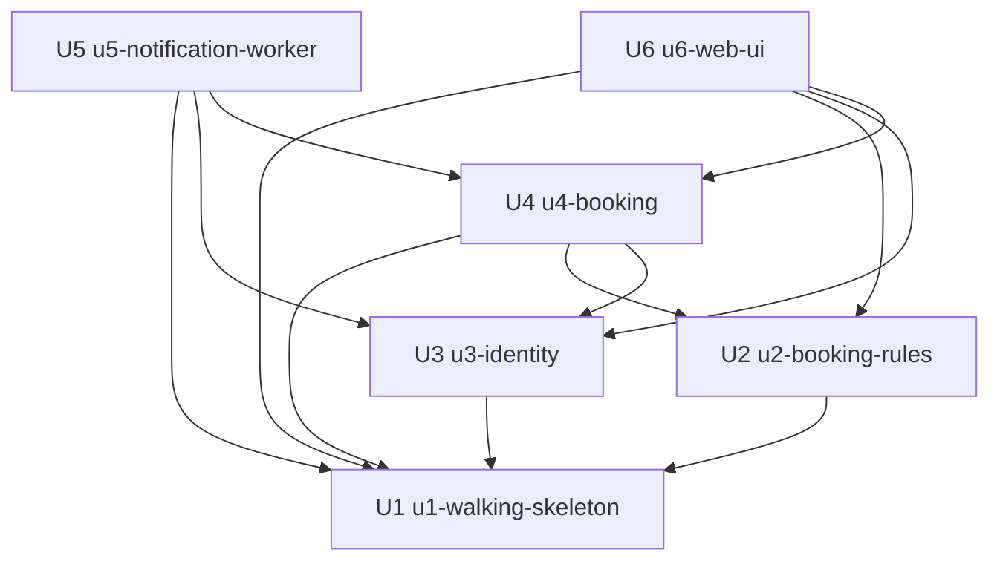

# 작업 단위 의존 관계 — 팀 회의실 예약

입력은 두 문서다.
- `unit-of-work.md`: 작업 단위 U1–U6
- `inception/domain-design/components.md`: 구성 요소 간 `depends_on`

이 문서는 "어느 단위가 어느 단위의 코드 없이는 빌드하거나 테스트할 수 없는가"만 기록한다. 무엇을 먼저 만들지, 어느 경로가 가장 중요한지는 Delivery Planning에서 정한다.

## 의존 관계 (기계 판독용)

```yaml
units:
  - name: u1-walking-skeleton
    kind: service
    depends_on: []
  - name: u2-booking-rules
    kind: library
    depends_on: [u1-walking-skeleton]
  - name: u3-identity
    kind: service
    depends_on: [u1-walking-skeleton]
  - name: u4-booking
    kind: service
    depends_on: [u1-walking-skeleton, u2-booking-rules, u3-identity]
  - name: u5-notification-worker
    kind: service
    depends_on: [u1-walking-skeleton, u3-identity, u4-booking]
  - name: u6-web-ui
    kind: ui
    depends_on: [u1-walking-skeleton, u2-booking-rules, u3-identity, u4-booking]
```

## 의존 그림



<!-- Text fallback: 화살표는 "왼쪽이 오른쪽에 의존한다"는 뜻이다. U2와 U3은 U1에만 의존한다. U4는 U1, U2, U3에 의존한다. U5는 U1, U3, U4에 의존한다. U6은 U1, U2, U3, U4에 의존한다. U1은 아무것에도 의존하지 않는다. 순환은 없다. -->

## 의존 이유

| 단위 | 의존 대상 | 이유 |
|---|---|---|
| U2 | U1 | `shared` 패키지와 Vitest 설정은 U1의 저장소 뼈대에 있다. |
| U3 | U1 | 사용자·세션 표, `api` 서버, 세션 쿠키 확인 최소판은 U1에 있다. |
| U4 | U1 | 예약·회의실 표, 겹침 금지 제약 최소판, 예약 생성 API 최소판은 U1에 있다. |
| U4 | U2 | 시간 규칙과 겹침 판정 함수를 쓴다. |
| U4 | U3 | 요청자 확인(세션)과 예약자 이름 조회를 쓴다. |
| U5 | U1 | `worker` 프로세스, 알림 대상 찾기 최소판, 읽기 전용 DB 역할 첫 판은 U1에 있다. |
| U5 | U3 | 알림 받을 사람의 연락처 읽기 전용 조회를 쓴다. |
| U5 | U4 | 알림 후보 조회와 예약 유효성 확인 함수를 쓴다. |
| U6 | U1 | `web` 패키지, 로그인 화면, 단순 표 최소판은 U1에 있다. |
| U6 | U2 | 칸 활성 여부와 입력 미리 검사에 규칙 함수를 쓴다. |
| U6 | U3 | 가입·로그인·로그아웃 API를 부른다. |
| U6 | U4 | 현황·예약·취소 API를 부른다. |

## 통합 지점

| 단위 사이 | 방식 | 확정 시점 |
|---|---|---|
| U6 → U3, U4 | HTTP JSON API. 같은 출처이며 세션 쿠키를 쓴다. | Contract Design |
| U4, U6 → U2 | `shared` 패키지 함수 호출 | Contract Design(함수 모양), Functional Design(규칙 상세) |
| U5 → U3, U4 | `shared`에 둔 읽기 전용 조회 함수를 거쳐 PostgreSQL을 직접 읽는다. 읽기 전용 DB 역할을 쓴다(Q3). | Contract Design |
| U3, U4, U5 | 같은 PostgreSQL을 쓰지만, 표마다 쓰는 단위는 하나다. | Functional Design(스키마) |

## 함께 만들 수 있는 단위

서로 의존하지 않는 단위끼리는 각자 따로 복사한 프로젝트에서 동시에 만들 수 있다.

- U1이 끝난 뒤에는 U2와 U3이 서로 의존하지 않는다.
- U4가 끝난 뒤에는 U5와 U6이 서로 의존하지 않는다.

가능한 위상 순서는 여럿이다. 예를 들어 U1 → U2 → U3 → U4 → U5 → U6도 되고, U1 → U3 → U2 → U4 → U6 → U5도 된다. 어떤 순서로 할지는 Delivery Planning이 정한다.

## walking skeleton

팀 규칙에 따라(`team-practices.md` Walking Skeleton) U1이 얇은 조각이다. U1은 의존이 없으므로 의존 순서상 맨 앞에 온다.

U1은 다른 단위 없이 혼자 끝까지 돈다. 그 안에 다음이 모두 들어 있기 때문이다.
- Identity·RoomCatalog·Booking·Notification·WebUI 최소판
- 마이그레이션과 초기 데이터
- docker compose와 `npm run dev`

그래서 U1만으로 "시험 계정 로그인 → 회의실 목록 → 예약 생성 → 작업자 로그에 예약 ID"를 실제로 보일 수 있다. 시연 장면과 검증 명령은 Delivery Planning과 Construction에서 사람이 확정한다.
