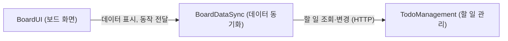

# 구성 요소 카탈로그 — 팀 할 일 보드

근거: 요구사항 `inception/requirements-analysis/requirements.md`(FR1~FR8, NFR1~NFR8), 스토리 `inception/user-stories/stories.md`(US1.1~US8.2), 화면 시안 `inception/refined-mockups/`, 팀 작업 방식 `inception/practices-discovery/team-practices.md`(한 저장소 `client/`·`server/`, TypeScript), 질문 답변 `domain-design-questions.md`. 결정 기록은 `decisions.md`.

> 변경: 승인 단계에서 "할 일과 담당자를 따로 두지 말고, 담당자는 할 일의 속성 하나로 단순하게"(팀원 목록 없이 이름만 입력) 요청이 있어, 팀원 명부(TeamRoster)와 Member 엔터티를 없애고 담당자를 할 일의 `assigneeName` 속성으로 바꿨습니다(ADR-006). 이에 따라 질문 Q1·Q2의 답은 더 이상 적용되지 않고, Q3·Q4의 답은 그대로 적용됩니다.

구성 요소는 **직접 작성하는 코드의 단위**입니다. SQLite와 브라우저는 구성 요소가 쓰는 외부 의존성입니다. 서버 하나로 묶을지 등 배포 형태는 Units Generation에서 정합니다. 엔터티는 소유와 모양(속성 이름)까지만 적고, 자료형·검증·관계 개수는 Functional Design에서 정합니다.

## 카탈로그 (기계 판독용)

```yaml
components:
  - name: TodoManagement
    summary: 할 일의 생성, 칸 단위 수정(제목·설명 / 담당자 이름 / 완료), 삭제, 목록 제공
    behaviour: >
      제목(앞뒤 공백 제거 후 1~100자), 설명(0~1000자), 담당자 이름(앞뒤 공백 제거 후 0~30자,
      0자는 미지정)을 서버에서 검증하고, 담당자 이름은 앞뒤 공백을 지운 값으로 저장한다(FR1.2, FR2.1, FR3.2, FR5.1).
      수정은 바뀐 칸만 저장한다: 제목·설명 수정, 담당자 이름 지정, 완료 표시는 서로 다른 칸만 바꾸며,
      같은 칸을 동시에 바꾼 경우에만 나중에 처리된 요청이 남는다(FR7.2, ADR-004).
      없는 할 일을 수정·완료·삭제하려 하면 "없음"으로 응답한다(FR5.3).
      목록은 만든 시각이 최근인 순, 같으면 ID 순으로 준다(FR6.1).
      한 번의 변경은 한 건의 저장으로 모두 되거나 모두 안 된다(NFR3).
      사용자 입력 글은 저장할 때 바꾸지 않고(앞뒤 공백 제거 제외), 데이터베이스 질의는 매개변수 바인딩만 쓴다(NFR2).
    responsibilities:
      - 할 일 엔터티(담당자 이름 포함)의 유일한 소유자이자 쓰기 주체
      - 할 일 입력 검증 규칙(서버 측)
      - 칸 단위 변경 규칙
      - 할 일 목록 정렬 규칙
    depends_on: []
    dependents:
      - component: BoardDataSync
        interaction: 할 일 목록 조회와 생성·제목설명 수정·담당자 지정·완료·삭제 요청(HTTP)
    external_dependencies:
      - name: SQLite
        kind: database
        purpose: 할 일 저장(파일 하나, 서버 재시작 후에도 유지)
    entities:
      - name: Todo
        identifier: id
        attributes: [id, title, description, assigneeName, done, createdAt, updatedAt]

  - name: BoardDataSync
    summary: 화면과 서버 사이의 데이터 주고받기, 10초 자동 갱신, 응답 순서와 편집 보호 관리
    behaviour: >
      탭이 보이는 동안 10초마다 할 일 목록을 가져오고, 탭이 다시 보이면 즉시 한 번 가져온다(FR7.1).
      늦게 도착한 이전 요청의 응답은 버리고 가장 나중에 보낸 요청의 결과만 반영한다(FR7.4).
      편집 중인 할 일의 칸과 입력 중인 칸은 갱신 결과로 덮어쓰지 않는다(FR5.4).
      갱신이 실패하면 마지막으로 성공한 데이터와 그 시각을 유지하고 실패 상태를 알린 뒤 다음 주기에 다시 시도한다(FR7.3).
      서버 응답을 화면이 쓰는 결과로 바꾼다: 칸별 검증 오류, 할 일 없음, 저장 실패(FR1.3, FR3.2, FR5.3, FR8.3).
      쓰기 요청은 서버가 성공을 돌려준 뒤에만 화면 데이터를 확정하고, 같은 대상·같은 칸에 대한 요청이 진행 중이면 다시 보내지 않는다(FR1.4).
    responsibilities:
      - 서버 API 호출(할 일)
      - 화면에 보이는 할 일 데이터와 마지막 갱신 상태 보관
      - 자동 갱신 주기, 응답 순서, 편집 보호 규칙
      - 서버 오류를 화면용 결과로 변환
    depends_on:
      - component: TodoManagement
        interaction: 할 일 조회와 변경 요청
        style: sync
    dependents:
      - component: BoardUI
        interaction: 데이터 구독, 사용자 동작을 변경 요청으로 전달
    external_dependencies: []
    entities: []

  - name: BoardUI
    summary: 보드 화면(목록, 추가 입력란, 담당자 이름 자동 완성, 필터, 개수 요약, 확인 대화 상자, 알림)
    behaviour: >
      화면 시안 S1~S11과 상호작용 명세의 상태·키보드 동작·화면 읽기 안내를 따른다(NFR5, WCAG 2.1 AA).
      제목·설명·담당자 이름 칸에 화면 쪽 검증(서버와 같은 규칙)을 하고 오류를 칸 아래 보여 주며 입력을 지우지 않는다(FR1.3, FR2.1).
      담당자 이름은 앞뒤 공백 제거, 유니코드 NFC, 대소문자 무시로 같은 이름을 판정해 묶고(표시는 가장 최근 표기),
      이를 담당자 필터 선택지와 자동 완성 후보에 쓴다(FR2.2, FR2.3, FR6.3, ADR-007).
      상태·담당자 필터와 개수 요약은 화면 안에서 계산한다(FR6.2, FR6.3, FR6.6).
      빈 보드, 필터 결과 없음, 불러오는 중, 불러오기 실패를 서로 다르게 보여 준다(FR6.4, FR6.5).
      할 일 삭제는 제목이 들어간 확인 대화 상자를 거친다(FR5.2).
      사용자가 입력한 글은 글자로만 출력하고 HTML로 해석하지 않는다(NFR2).
    responsibilities:
      - 화면 부품과 상태 표시
      - 화면 쪽 입력 검증과 오류 표시
      - 담당자 이름 묶기, 필터와 자동 완성 후보, 개수 요약 계산
      - 키보드·화면 읽기 접근성
    depends_on:
      - component: BoardDataSync
        interaction: 데이터 표시와 사용자 동작 전달
        style: sync
    dependents: []
    external_dependencies: []
    entities: []
```

## 구성 요소 그림



<!-- Text fallback: BoardUI는 BoardDataSync를 쓰고, BoardDataSync는 TodoManagement를 HTTP로 호출한다. 순환은 없다. -->

## 구성 요소 요약

| Component | Purpose | Depends On | Dependents | Entities Owned |
|---|---|---|---|---|
| TodoManagement | 할 일 생성·칸 단위 수정(담당자 이름 포함)·완료·삭제·목록 | (없음) | BoardDataSync | Todo |
| BoardDataSync | 서버 호출, 자동 갱신, 응답 순서, 편집 보호, 오류 변환 | TodoManagement | BoardUI | (없음) |
| BoardUI | 보드 화면 전체, 담당자 이름 묶기·자동 완성, 접근성 | BoardDataSync | (없음) | (없음) |

## 엔터티 소유

| Entity | Owning Component | Identifier | Attributes | References |
|---|---|---|---|---|
| Todo | TodoManagement | id | id, title, description, assigneeName, done, createdAt, updatedAt | (없음: 담당자는 다른 엔터티를 가리키지 않는 이름 속성) |

## 외부 의존성

| Component | Dependency | Kind | Purpose |
|---|---|---|---|
| TodoManagement | SQLite | database | 할 일 저장 |

## 근거

| 구성 요소 | 따로 두는 이유 |
|---|---|
| TodoManagement | 보드의 유일한 데이터(할 일)를 소유하고, 서버 검증·칸 단위 저장·목록 정렬이라는 고유 규칙이 있음 |
| BoardDataSync | 자동 갱신·응답 순서·편집 보호·오류 변환은 화면 모양과 무관하게 바뀌는 규칙이며, 화면 없이 단독으로 테스트해야 함(FR7, ADR-003) |
| BoardUI | 화면 부품, 담당자 이름 묶기, 접근성은 디자인 변경에 따라 바뀌며, 데이터 규칙과 분리해야 화면만 고치기 쉬움 |

### 선택하지 않은 분할

- **할 일 관리 + 팀원 명부 두 구성 요소**(원래 Q1 A): 승인 단계의 단순화 요청으로 팀원 목록 자체가 없어져 필요 없어졌습니다(ADR-001, ADR-006).
- **팀원 목록을 고르기용으로만 유지**: 팀원 관리 화면과 저장소가 남아 단순화 요청의 취지와 맞지 않아, 요청하신 분께 확인한 뒤 택하지 않았습니다(ADR-006).
- **화면 하나로 합치기**(Q3 B): 동기화 규칙을 화면 부품 테스트로만 확인하게 되어 늦은 응답·편집 보호 같은 경우를 재현하기 어렵습니다(ADR-003).
- **담당자 이름 묶기를 서버에서**: 서버가 정규화한 이름을 따로 저장하면 칸이 늘고 규칙이 두 곳에 생깁니다. 할 일 500건 규모(가정 A3)에서는 화면 계산으로 충분합니다(ADR-007).
