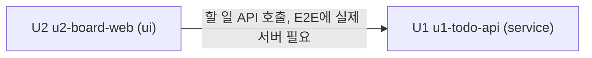

# 작업 단위 의존 관계 — 팀 할 일 보드

이 문서는 단위 사이의 의존 관계(무엇이 무엇에 기대는지)만 적습니다. 만드는 순서와 출시 범위는 Delivery Planning에서 정합니다.

## 의존 그래프



<!-- Text fallback: U2(u2-board-web)는 U1(u1-todo-api)에 의존한다. U1은 다른 단위에 의존하지 않는다. 순환 없음. -->

| 단위 | 의존하는 단위 | 이유 |
|---|---|---|
| U1 u1-todo-api | (없음) | 서버 코드와 테스트는 U2 없이 빌드·통과함 |
| U2 u2-board-web | U1 u1-todo-api | 화면 단위의 핵심 흐름 E2E가 실제 U1 서버를 띄워 실행함(질문 Q3 A) |

## 연결 지점

| 연결 | 방향 | 방식 | 내용 |
|---|---|---|---|
| 할 일 API | U2 BoardDataSync → U1 TodoManagement | HTTP + JSON(동기 요청) | 할 일 조회, 생성, 제목·설명 수정, 담당자 이름 지정, 완료 표시, 삭제. 오류는 `{ "error": { "code", "message" } }`. 세부 계약은 Contract Design에서 정함 |
| 화면 파일 제공 | U1 → 브라우저 | 정적 파일 | U2의 빌드 결과를 U1이 같은 주소에서 제공(질문 Q2 A). 공유 데이터 없음 |

두 단위는 데이터 저장소를 공유하지 않습니다. 할 일 데이터는 U1만 읽고 씁니다.

## 동시에 만들 수 있는 단위

없습니다. U2가 U1에 의존하므로 가능한 순서는 U1 → U2 하나뿐입니다. (질문 Q3에서 B를 골랐다면 두 단위를 동시에 만들 수 있었습니다.)

## 기계 판독용 의존 목록

```yaml
units:
  - name: u1-todo-api
    kind: service
    depends_on: []
  - name: u2-board-web
    kind: ui
    depends_on: [u1-todo-api]
```
