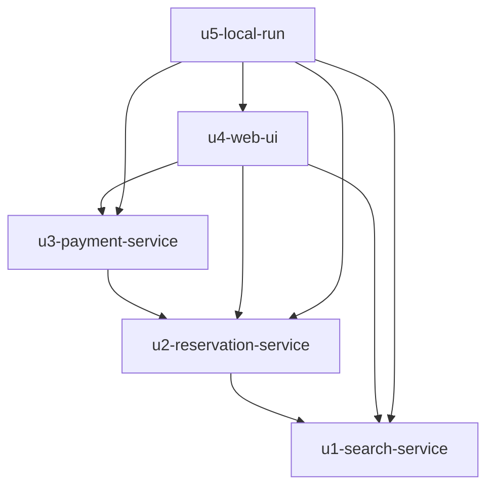

# Unit Dependency

## Sources

- [scope] Workflow-selected scope: classic
- [Q1] 백엔드 3개 서비스
- [Q3] 화면은 Vite 프록시로 각 서비스에 연결
- [memory:M1] unit-of-work.md의 유닛 5개, components.md의 컴포넌트 의존(Payment → Reservation → Recommendation)

이 문서는 무엇이 무엇에 의존할 수 있는지(위상)만 적는다. 먼저 만들 순서나 핵심 경로는 Delivery Planning에서 정한다.

## 의존 방향 (A depends on B)

- U2 u2-reservation-service는 U1 u1-search-service에 의존한다. 예약 생성 때 주차권 가격·주차장 정보를 조회하고 통합 시험에서 실제 U1을 쓴다.
- U3 u3-payment-service는 U2 u2-reservation-service에 의존한다. 대기 예약 생성과 결제 결과 반영을 U2에 요청한다.
- U4 u4-web-ui는 U1, U2, U3에 의존한다. 화면 통합 시험이 세 서비스를 모두 쓴다.
- U5 u5-local-run은 U1, U2, U3, U4에 의존한다. 모두를 기동하는 스크립트다.
- 순환 의존은 없다.



## 연동 지점

| 호출자 | 대상 | 방식 | 내용 |
|---|---|---|---|
| U4 화면 | U1 | 동기 HTTP (Vite 프록시) | 음성 텍스트로 추천 요청 |
| U4 화면 | U3 | 동기 HTTP (Vite 프록시) | 후보 선택 후 결제 요청 |
| U4 화면 | U2 | SSE와 동기 HTTP (Vite 프록시) | 예약 상태 푸시 구독, 현재 상태 조회 |
| U2 | U1 | 동기 HTTP | 선택한 주차권의 가격과 주차장 정보 조회 |
| U3 | U2 | 동기 HTTP | 대기 예약 생성, 결제 결과 반영 |
| U3 모의 PG | U3 웹훅 | 비동기 HTTP (자기 호출) | 승인·실패 결과 전달 |

U2 안의 Reservation과 Notification 사이 알림은 같은 프로세스 안의 이벤트이므로 서비스 간 연동이 아니다.

## 병렬 개발 기회

- 의존 간선이 없는 유닛 쌍은 없다. 모든 유닛이 직렬에 가까운 사슬이다.
- 사슬을 쓰되 서비스 간 계약(Contract Design)이 먼저 정해지면 계약 기준의 가짜 응답(stub)으로 병렬 시험이 가능하다. 계약 단계 이후에 다시 평가한다.

## 간선 블록

```yaml
units:
  - name: u1-search-service
    kind: service
    depends_on: []
  - name: u2-reservation-service
    kind: service
    depends_on: [u1-search-service]
  - name: u3-payment-service
    kind: service
    depends_on: [u2-reservation-service]
  - name: u4-web-ui
    kind: ui
    depends_on: [u1-search-service, u2-reservation-service, u3-payment-service]
  - name: u5-local-run
    kind: packaging
    depends_on: [u1-search-service, u2-reservation-service, u3-payment-service, u4-web-ui]
```
